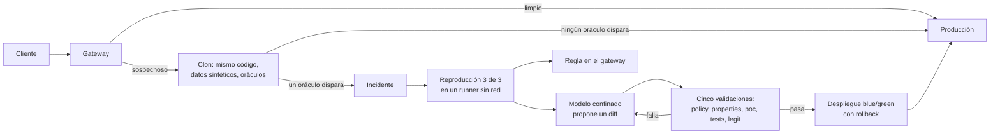

# team-25 Platanus Hack 26: Santiago ft. Buk Project

**Current project logo:** project-logo.png


Track: 🔧 Hardware

team-25

- Nicolás Funes ([@nicolas152](https://github.com/nicolas152))
- Bautista Silvano ([@hernei152](https://github.com/hernei152))
- Isidro Pasman ([@isidropasman](https://github.com/isidropasman))
- Uriel Gandelman ([@UriGandel](https://github.com/UriGandel))

## Qué es Inmune

Inmune es un proxy inverso que se pone delante de una aplicación web. Ejecuta cada request sospechoso primero en
un clon de la misma aplicación, con el mismo código y datos sintéticos, y observa lo que la aplicación hace: la
consulta SQL, los archivos que abre, los procesos, las conexiones y si devuelve datos de otro dueño. Si el ataque
funciona en el clon, queda confirmado por ejecución y no por un puntaje. El gateway contiene entonces el punto
vulnerable con una regla acotada a esa ruta y, cuando el defecto está en un parámetro, a ese parámetro. Un modelo
confinado propone un parche de código, que solo se despliega si pasa cinco validaciones mecánicas.

## Cómo funciona



1. **Clasificar.** El gateway marca como sospechoso un request por su forma (valores fuera de gramática o de
   esquema, segmentos `..`, rutas de dueño con identidad no confiable), no por IP ni por historial.
2. **Detonar.** El request sospechoso se ejecuta en un clon. Si ningún oráculo dispara, se reenvía a producción
   y el cliente recibe la respuesta real: un falso positivo cuesta latencia. La excepción es una ruta con un
   segmento `..`, que se niega aunque el clon no dispare nada.
3. **Contener.** Si un oráculo dispara, la sesión queda atendida por un clon. El pipeline reproduce el
   incidente tres veces de tres y, solo entonces, publica una regla en el gateway.
4. **Parchar.** Un modelo que solo puede leer una copia del código y editar una lista de archivos propone un
   diff. No decide nada: el parche pasa por cinco validaciones, se despliega en blue/green y se verifica.

El recorrido completo, con la tabla de decisiones del gateway, está en [docs/arquitectura.md](docs/arquitectura.md).

## Inicio rápido

Requisitos: Linux con Docker Engine utilizable sin `sudo`, el plugin Docker Compose, git y Python 3.12 o posterior
con el módulo `venv` (Debian y Ubuntu: `python3-venv`). Hace falta acceso a PyPI, a Docker Hub y a los mirrors de
Debian una vez.
Opcional: la CLI de Claude Code (`claude`) con sesión iniciada, para los parches automáticos y los pasos con
modelo de `immune init`.

### 1. Instalar

```bash
git clone https://github.com/platanus-hack/platanus-hack-26-cl-team-25.git inmune
cd inmune
./install.sh
immune doctor --prereqs
```

`install.sh` no usa `sudo`, se puede volver a ejecutar y dice qué falta. Crea `.venv`, construye las imágenes y
enlaza el comando `immune` en `~/.local/bin`. Si ese directorio no está en el `PATH`, use `bin/immune`.

### 2. Demo incorporado

El demo es una tienda (FastAPI + SQLite, en `victim/`) con siete defectos plantados.

```bash
immune up        # desde la raíz del checkout
immune status    # termina con "healthy"
```

- Tienda, a través del gateway: `http://127.0.0.1:8080`
- Panel en vivo: `http://127.0.0.1:8090`

Envíe un ataque, por ejemplo la inyección SQL en la búsqueda:

```bash
curl -s "http://127.0.0.1:8080/api/products?q=zzzzzz%27%20OR%20%271%27%3D%271"
```

La respuesta sale de un clon, con datos sintéticos. En el panel aparecen el incidente, la regla, el diff, el
resultado de cada validación y el despliegue. `immune report` da el resumen en la terminal. Las demás peticiones
de prueba están en `docs/demo/respuestas/tienda.md`.

```bash
immune reset     # vuelve al estado inicial
immune down      # detiene todo
```

### 3. Su propia aplicación

`immune init` soporta aplicaciones Python ASGI que exponen `openapi()` (FastAPI) con una base SQLite.

```bash
cd /ruta/a/su-app
immune init      # analiza la app, escribe .immune/, se verifica; termina con READY o NEEDS ATTENTION
immune up
```

`immune init` escribe `autopatch: pr`: los parches que pasan las validaciones quedan como pull request abierto.
`immune autopatch merge` activa el merge y el despliegue automáticos.

Para otros lenguajes existe un runtime genérico con oráculos fuera del proceso (`strace` y un proxy de Postgres),
pero su perfil se escribe a mano; el ejemplo es `examples/tareas-node/`. Comandos, modos, puertos y recuperación:
[docs/operacion.md](docs/operacion.md).

## Qué se midió

Todas las cifras, con fecha, máquina, método y archivo de datos, están en [docs/resultados.md](docs/resultados.md).

- **Tiempo a parche (2026-11-21, ARM64 de 4 núcleos compartida, 7 defectos × 3 rondas):** 21 de 21 incidentes
  parchados por el modelo en el primer intento. Medianas desde que se abre el incidente: regla activa a los 1.9 s,
  release parchado en producción a los 24.9 s, verificado a través del gateway a los 51.3 s. Estas cifras son
  anteriores a las correcciones de la auditoría del 2026-11-22 y no se volvieron a medir; en ese momento la lista
  de defectos plantados estaba dentro del árbol que el generador de parches podía leer.
- **Tests (2026-11-22):** 754 pasan y 6 quedan deseleccionados (los que llaman al modelo, no ejecutados) de 760.
- **Autotest de las validaciones (2026-11-22):** los 7 parches escritos a mano pasan las cinco validaciones y los
  15 parches inadecuados son rechazados por la validación esperada.
- **Modo de anticipación sobre Apache httpd 2.4.49 (2026-11-21):** el parche sugerido y el cambio oficial de
  2.4.50 cumplen 21 de 21 propiedades y coinciden en los 21 vectores, sobre la función extraída y no sobre un
  servidor en marcha. El defecto es público: demuestra el mecanismo, no un descubrimiento a ciegas.

## Límites

La lista completa está en [docs/limites.md](docs/limites.md). Los principales:

- El sistema aprende solo de lo que sus oráculos ven. Fallas de lógica de negocio, IDOR de escritura y ataques de
  segundo orden no disparan ninguno.
- Sin una regla activa, una detonación sin veredicto concluyente deja pasar el request a producción.
- La validación `policy` es una heurística sintáctica, y no hay un segundo modelo revisor.
- Los defectos de las aplicaciones de demostración están plantados por el equipo. No hubo equipo rojo ni revisión
  independiente.
- `immune init` cubre FastAPI con SQLite. `immune deploy`, que pondría el gateway delante de un servicio
  existente, es un esbozo experimental; el camino que funciona es `immune up`.

## Mapa del repositorio

| Directorio | Función |
|---|---|
| `gateway/` | Proxy inverso: clasifica, detona en un clon, decide, aplica reglas, graba |
| `shadow/` | Instrumentación en proceso de una app Python ASGI dentro de cada clon: oráculos y veredicto |
| `sidecar/` | Oráculos fuera del proceso para cualquier lenguaje: `strace` y proxy de Postgres |
| `fleet/` | Pool de clones y despliegue blue/green |
| `pipeline/` | Incidente, reproducción, regla, parche, cinco validaciones, PR, despliegue, verificación; auditoría de clase |
| `patcher/` | Prompt, llamada a la CLI `claude` confinada, regla y variantes del PoC, parches de respaldo |
| `dashboard/` | Bus de eventos y panel en vivo |
| `immune/` | CLI `immune` |
| `immune_contracts/` | Código compartido: token, gramática, headers internos, tipos de evento |
| `sim/` | Tráfico legítimo de la tienda y cinco escenarios guionados |
| `anticipate/` | Modo de revisión de código fuente, demostrado sobre Apache httpd 2.4.49 |
| `victim/` | Aplicación de demostración "Tienda": FastAPI + SQLite, 7 defectos plantados |
| `examples/notas/` | Segunda aplicación de demostración: FastAPI + SQLite, 4 defectos plantados |
| `examples/tareas-node/` | Tercera aplicación de demostración: Node + Postgres, 3 defectos plantados, runtime genérico |
| `labs/grafana-cve-2021-43798/` | Laboratorio guionado sobre Grafana 8.3.0 sin modificar; solo regla, sin parche |
| `acceptance/` | Tests de aceptación de la tienda, la instrumentación y el gateway |
| `contracts/` | Contratos de referencia: procesos, protocolos, eventos, configuración |
| `deploy/` | Dockerfiles, archivo de Compose y dependencias fijadas |
| `docs/` | Documentación |

## Documentación

| Documento | Para qué |
|---|---|
| [docs/README.md](docs/README.md) | Índice completo |
| [docs/arquitectura.md](docs/arquitectura.md) | Cómo fluye un request y un incidente; fronteras de confianza; qué está construido |
| [docs/validaciones.md](docs/validaciones.md) | Qué garantiza y qué no cada validación del parche |
| [docs/operacion.md](docs/operacion.md) | Instalación, comandos, puertos, secretos, tests, recuperación |
| [docs/resultados.md](docs/resultados.md) | Resultados medidos |
| [docs/limites.md](docs/limites.md) | Límites y partes no construidas |
| [docs/decisiones.md](docs/decisiones.md) | Decisiones de diseño y sus razones |
| [docs/proceso.md](docs/proceso.md) | Cómo se construyó y cómo auditarlo |
| [contracts/README.md](contracts/README.md) | Contratos entre procesos (en inglés) |
