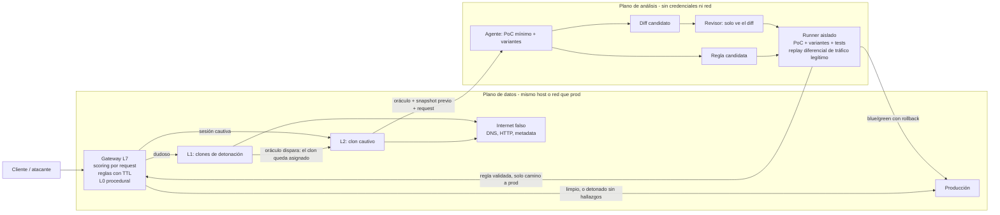

# Sistema inmunológico autónomo — arquitectura v2

Revisión estricta de la v1 (`arquitectura-sistema-inmunologico.md`) y arquitectura corregida.
Las cifras de latencia de la v1 no fueron re-verificadas; acá no se depende de ellas.

## 1. Qué se conserva de la v1

- El señuelo corre **el código real** (gemelo sombra), no un servicio falso.
- **Nada arranca en el camino crítico**: se asigna desde un pool ya caliente.
- El **PoC ejecutable** es el artefacto central; lo que dice el LLM solo vale si se verifica mecánicamente.
- Remediación en dos velocidades: "bloqueado en segundos, curado en minutos".

## 2. Fallas de la v1

### Críticas (rompen la premisa)

| # | Falla | Por qué rompe |
|---|---|---|
| F1 | **La detección por score necesita historial.** Tasa, entropía de rutas y timing son features de sesión. | Los primeros requests siempre llegan a prod. Un exploit de un solo disparo (explotación masiva de un CVE conocido, sin reconocimiento previo) nunca se desvía. El sistema solo atrapa atacantes ruidosos. |
| F2 | **"Nunca desviar sesiones autenticadas".** | Registrar una cuenta alcanza para volverse inmune. La mayoría de los bugs serios (IDOR, SQLi en endpoints internos) están detrás del login. |
| F3 | **Inyección de prompt al agente defensivo.** El payload es texto del atacante y entra a un LLM cuyo output termina en prod. | El atacante puede dirigir el parche: introducir una puerta trasera o desactivar un control. La v1 no lo menciona. |
| F4 | **Autoinmunidad.** El nivel 0 bloquea por huella (JA4 lo comparten todos los clientes con la misma librería TLS) y el nivel 1 genera reglas de forma autónoma "porque son reversibles". | Un atacante fabrica ataques con la forma del tráfico legítimo (p. ej. del checkout) e induce una regla que tumba a los clientes reales. Además, bloquear contradice la premisa de no alertar. |
| F5 | **Una microVM de un solo uso por huella.** | Rotar IP o huella cuesta cero; cada rotación nos cuesta 128–512 MB. El pool se agota y la asimetría de costos queda a favor del atacante. El tarpit (retener mucho) y el pool (rotar rápido) tiran en direcciones opuestas. |

### Altas

| # | Falla | Consecuencia |
|---|---|---|
| F6 | **Oráculo diferencial.** Con un segundo punto de vista limpio (otra IP), el atacante compara respuestas: datos públicos distintos o estado propio que no aparece delatan el señuelo. | La clave sticky "por huella" es débil en los dos sentidos: colisiona entre usuarios (JA4, CGNAT) y se evade rotando. |
| F7 | **Egress denegado sin simulación.** | SSRF, reverse shells, exfiltración por DNS y descarga de segunda etapa fallan en el señuelo y funcionarían en prod: delata la trampa y se pierde la captura de la etapa 2. |
| F8 | **No se define qué es "el exploit funcionó".** Syscalls y pcap no ven bugs de lógica. | IDOR y fallas de autorización no disparan ningún sink; pasan sin ser detectados. |
| F9 | **Validación de parche insuficiente.** "El PoC falla y la suite pasa" lo cumple un parche que filtra ese payload exacto o que borra la funcionalidad. | Parches sobreajustados: la variante siguiente del exploit vuelve a entrar. |
| F10 | **No dice dónde aplican las reglas ni qué versión corre el cautivo.** | Si la regla también filtra el camino al señuelo, el atacante ve el cambio. Si prod se redeploya, el PoC queda validado contra una versión vieja. |
| F11 | **Replay re-inyectando bytes desde pcap.** | Frágil con tokens de sesión, CSRF y nonces por clon, y con exploits de varios pasos. El gateway ya ve el texto plano: el pcap sobra. |

### Medias

| # | Falla |
|---|---|
| F12 | **seccomp no se aplica en caliente** a un proceso ya corriendo (lo instala el propio proceso; requiere reinicio). eBPF-LSM sí, pero exige kernel con `CONFIG_BPF_LSM` y `lsm=bpf` y privilegios en el host del cliente. "En segundos" solo vale para la regla del gateway. |
| F13 | **La base de datos no está dimensionada.** Cada clon necesita su propio estado de base; con la base adentro, 128–256 MB no alcanza y la densidad "de miles" baja. El page-in perezoso hace más lento el primer request: es una huella de timing. |
| F14 | **Contradicción de soberanía.** Dice que los payloads no salen del país y a la vez pone el análisis en Alemania; además el LLM por API recibe payloads y código fuente del cliente. |
| F15 | **Gateway inline propio sin modo de falla definido.** Es un punto único de falla delante de prod. |
| F16 | **Sobre-ingeniería para un MVP.** XDP (el problema no es volumétrico), GBDT (no hay datos para entrenarlo), orquestador Firecracker (2–3 meses según la propia v1), LLM local dentro del señuelo (con código real no hace falta). |

## 3. Cambios de diseño

### C1. El veredicto lo da la evidencia, no el score (resuelve F1, F2, F4 en parte)

El score deja de decidir quién es atacante. Solo decide **a quién se detona**.

```
request ─► GATEWAY
            ├─ limpio ───────────────► PROD
            ├─ dudoso ──► DETONACIÓN en sombra ──┬─ ningún oráculo dispara ─► PROD (reenvío)
            │                                    └─ oráculo dispara ─► CAUTIVO
            └─ cautivo (ya confirmado) ─► su clon
```

- **Detonación:** el request dudoso se ejecuta primero en un clon sombra. Si ningún oráculo dispara, se reenvía a prod y el cliente recibe la respuesta real. El costo de un falso positivo pasa de "le servimos datos falsos" a "unas decenas de ms extra".
- **Cautiverio:** solo con evidencia mecánica (oráculo disparado o honeytoken tocado). El clon donde detonó **pasa a ser** el clon del atacante: ya tiene su estado, no hay que trasplantar nada.
- **Un disparo:** el contenido del request alcanza para marcarlo dudoso (forma de payload, ruta inexistente, parámetro fuera de gramática). No hace falta historial, así que el primer request ya puede detonarse.
- **Límite:** la detonación tiene fidelidad parcial cuando el request depende de datos que solo existen en prod (ver C3).

### C2. Oráculos explícitos (resuelve F8)

Instrumentación dentro del gemelo sombra. Cada uno es un sí/no mecánico:

| Oráculo | Detecta |
|---|---|
| La estructura de la query SQL difiere de su plantilla | SQLi |
| Apertura de archivo fuera de la raíz permitida | Path traversal, LFI |
| Proceso hijo o `exec` no esperado | RCE, inyección de comandos |
| Conexión saliente a destino no declarado | SSRF, reverse shell |
| Lectura de una fila o recurso **canario** por una identidad que no es su dueña | IDOR, fallas de autorización |
| Uso de un honeytoken (credencial, JWT, clave falsa) | Robo de credenciales; también identifica al mismo actor desde otra IP |

### C3. Confianza de identidad en vez de "autenticado" (resuelve F2)

- No se desvía ni se detona con datos falsos a identidades con **confianza establecida**: antigüedad, historial de uso, MFA, pagos.
- Una cuenta creada hace minutos desde una sesión dudosa **es del atacante** y sí entra al flujo. Al capturarla, el gateway crea en el clon una persona equivalente (mismo usuario e id, resto sintético) y traduce la cookie.
- Límite que queda: una cuenta real comprometida con buena reputación no se desvía; para ella solo aplican las reglas de C6.

### C4. Señuelos por niveles (resuelve F5)

| Nivel | Qué es | Costo por atacante | Cuándo |
|---|---|---|---|
| L0 | Respuestas procedurales sin estado desde el gateway (rutas que la app no tiene, paginación infinita, goteo lento) | ~0 | Reconocimiento masivo |
| L1 | Clones sombra compartidos para detonación, reciclados cada N requests o al disparar un oráculo | bajo | Requests dudosos |
| L2 | Clon dedicado (cautivo) | un clon | Solo con evidencia |

- Tope de cautivos por origen y global. Un cautivo inactivo se pausa y luego se baja a disco.
- Si el pool se agota: el tráfico va a prod protegido por las reglas vigentes. Nunca peor que no tener el sistema.

### C5. Indistinguibilidad (resuelve F6, F7, F13)

- **Datos públicos idénticos a prod** (catálogo, páginas, conteos visibles). Solo lo privado es sintético.
- **Honeytokens como pegamento de identidad:** si una credencial robada del señuelo aparece desde una IP limpia, esa sesión es el mismo actor y se captura.
- **Internet falso:** el egress del clon no se corta, se redirige a un sumidero: DNS que responde todo, HTTP genérico y un endpoint de metadata de nube (`169.254.169.254`) con credenciales señuelo. El exploit "funciona" y se captura la etapa 2.
- **Base de datos dentro del snapshot** y working set pre-cargado, para que el primer request no sea más lento que en prod.
- Límite que queda: el estado que el atacante escribe en el señuelo no es visible desde un punto de vista limpio hasta que ese punto se captura.

### C6. Reglas que no pueden volverse contra nosotros (resuelve F4, F10, F12)

Una regla solo se activa si pasa todo esto, de forma automática:

1. **Replay contra un corpus de tráfico legítimo reciente** (grabado en el gateway): cero coincidencias, o por debajo de un umbral fijo.
2. **Alcance mínimo:** ruta + parámetro + gramática. Nunca por huella, IP ni user-agent.
3. **Solo en el camino a prod.** Los clones sombra siguen vulnerables para que el cautivo no vea cambios.
4. **TTL:** caduca cuando el parche de código está desplegado.
5. **Reversión automática** si la tasa de coincidencias sobre tráfico limpio supera el umbral; presupuesto máximo de reglas activas.

No hay nivel 0 de bloqueo: al atacante confirmado se lo sigue desviando. La regla de kernel queda fuera del MVP.

### C7. El agente no decide, propone (resuelve F3, F9)

- **Entrada:** primero la evidencia mecánica (oráculo, stack trace, archivo y línea). El payload va como dato inerte y escapado, nunca como instrucción.
- **Sin poder:** el agente corre sin credenciales ni red. Su única salida es un diff.
- **Límites del diff:** solo archivos presentes en el stack trace; sin dependencias nuevas, sin llamadas de red ni `exec` nuevas; tamaño acotado.
- **Revisor independiente:** un segundo modelo ve solo el diff y el código, nunca el payload.
- **Puertas de validación** (todas mecánicas, en el runner aislado):
  1. el PoC falla;
  2. una **familia de variantes** del PoC falla (otras codificaciones, otros parámetros, fuzzing corto con el oráculo como juez);
  3. la suite de tests pasa;
  4. **replay diferencial:** el corpus de tráfico legítimo da las mismas respuestas antes y después del parche.
- **Despliegue:** blue/green con rollback automático. En el demo, automático; en un cliente real, con aprobación humana hasta tener historial.
- El PoC se revalida contra **la versión actual de prod** antes de parchear (F10) y queda como test de regresión.

### C8. Captura por snapshot, no por replay de bytes (resuelve F11)

- El gateway graba los requests en texto plano por sesión (no hace falta pcap).
- Cuando un oráculo dispara, se toma un **snapshot del clon cautivo en el estado previo al request**. El PoC es "este estado + este request", lo que cubre exploits de varios pasos sin reconstruir tokens ni nonces.
- Límite: ataques de segundo orden (payload guardado que dispara cuando otro usuario lo ve) solo se detectan si algo en el clon lo ejecuta.

### C9. Operación (resuelve F14, F15, F16)

- **Fail-open:** si falla el scoring, el pool o el control plane, el gateway reenvía a prod con las reglas locales.
- **Soberanía:** el análisis corre junto al plano de datos, en el entorno del cliente. El LLM se consume por un endpoint en la región o nube del cliente; si eso no existe, se declara que payloads y código salen.
- **Fuera del MVP:** XDP, GBDT, Firecracker, LLM dentro del señuelo, eBPF-LSM. El scoring del MVP son reglas + honeytokens + forma del payload.

## 4. Arquitectura v2



## 5. Lo que se construye para el demo

Todo en un solo host (la VM ARM de 4 cores y 23 GB; no tiene KVM, así que Docker).
El gestor del pool habla con un **driver de sandbox** (`acquire`, `snapshot`, `reset`, `destroy`): Docker ahora, Firecracker después sin tocar el resto.

Orden de construcción:

1. **App víctima** con SQLi, path traversal e IDOR plantados, suite de tests y base con filas canario.
2. **Build sombra** de la misma app con los oráculos de C2 como hooks (driver de base, apertura de archivos, procesos, red).
3. **Gateway** (reverse proxy): scoring por request, tres caminos de C1, L0 procedural, grabación de requests, reglas con TTL.
4. **Pool** de 3–5 contenedores sombra con internet falso.
5. **Agente + runner**: PoC, regla validada contra el corpus, diff, puertas de C7, blue/green.
6. **Panel en vivo** con la línea de tiempo: detonación → cautiverio → regla → parche.

Recortes aceptados para el demo: un solo revisor, corpus de tráfico legítimo generado por script, familia de variantes chica, sin persona equivalente para cuentas (C3) salvo que sobre tiempo.

## 6. Límites que quedan abiertos

- Cuentas reales comprometidas con buena reputación (C3).
- Estado escrito en el señuelo que no aparece desde un punto de vista limpio (C5).
- Ataques de segundo orden (C8).
- La detonación suma latencia a la fracción dudosa y pierde fidelidad en requests que dependen de datos de prod (C1).
- Un atacante paciente que nunca dispara un oráculo no entrena nada: el sistema aprende solo de exploits que funcionan en la sombra.
