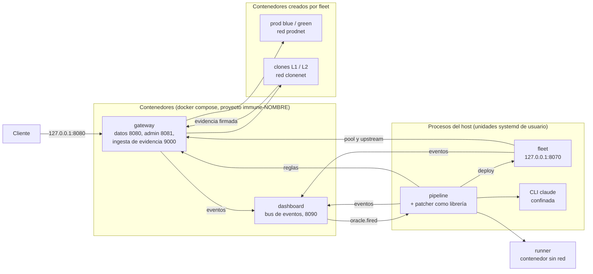
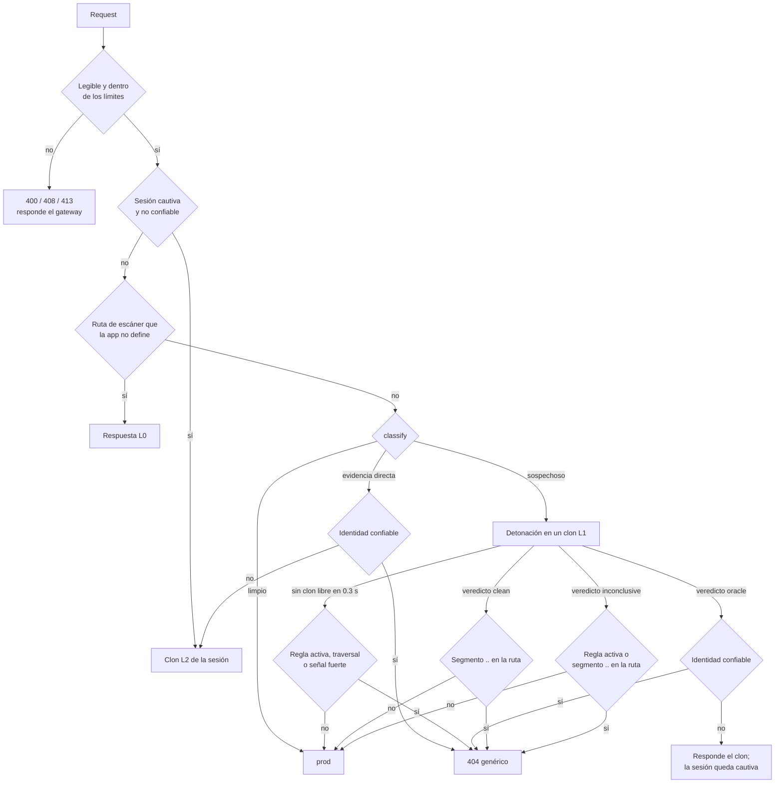
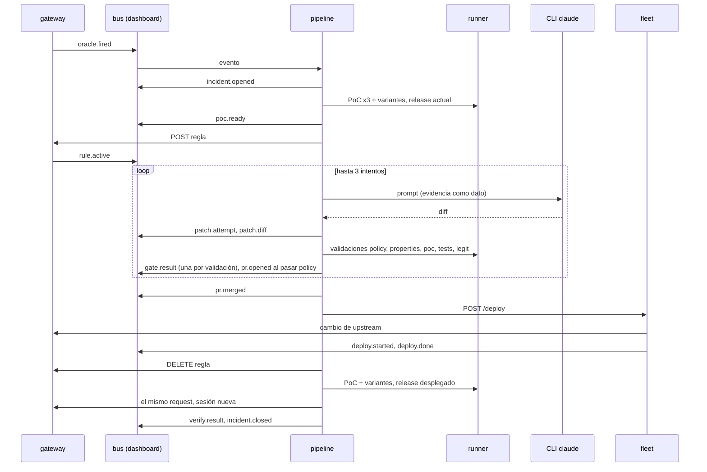

# Arquitectura

Tipo de documento: explicación. Describe la arquitectura tal como está construida.
Los comandos, puertos y variables están en [operacion.md](operacion.md); los protocolos y esquemas, en
[`contracts/`](../contracts/README.md); las razones de cada decisión, en [decisiones.md](decisiones.md); los
límites, en [limites.md](limites.md).

Inmune es un proxy inverso que se pone delante de una aplicación web. Cada request que considera sospechoso lo
ejecuta primero en una copia de la misma aplicación con datos sintéticos. Si ahí el ataque funciona, queda
confirmado por ejecución: el gateway contiene el punto vulnerable con una regla, y un pipeline propone un parche
de código, lo valida de forma mecánica y lo despliega.

## 1. Glosario

Estos términos se usan con el mismo significado en toda la documentación en español. Entre paréntesis, el término
de la documentación en inglés (`contracts/` y los README de cada módulo).

| Término | Significado |
|---|---|
| **prod** | La aplicación protegida, con sus datos reales. Corre desde un *release*. |
| **release** | Copia completa de las rutas `app.release_paths` del proyecto, en `<runtime>/releases/<id>/`. `t0` es el release inicial. Se monta de solo lectura en `/app`. |
| **clon** (*clone*) | Contenedor que corre el mismo release que prod, con una base de datos sintética (la *semilla sombra*) y con los oráculos activos. |
| **oráculo** (*oracle*) | Comprobación mecánica, de sí o no, sobre lo que la aplicación hizo al atender un request dentro de un clon. Hay cinco: `sql`, `file`, `proc`, `net`, `owner`. |
| **detonación** (*detonation*) | Ejecutar un request sospechoso en un clon antes de decidir si llega a prod. |
| **veredicto** (*verdict*) | Resultado de una detonación: `clean`, `oracle` o `inconclusive`. |
| **L0** | Respuestas falsas y deterministas del propio gateway para una lista fija de rutas de escáner. |
| **L1** | Clon compartido de detonación. Atiende un request y vuelve al estado de la semilla. |
| **L2** / **cautivo** (*captive*) | Sesión que disparó un oráculo y desde entonces es atendida solo por un clon dedicado, nunca por prod. |
| **marcador** (*marker*) | Cadena `MK` + 10 caracteres, distinta por dueño, incrustada en cada dato privado sintético. |
| **manifiesto** (*manifest*) | `manifest.json`: mayor uid de la semilla (`seed_max_uid`), dueño de cada objeto, ids canario. |
| **incidente** (*incident*) | Unidad de trabajo del pipeline: un oráculo disparado en una ruta y un parámetro. |
| **PoC** | Estado previo del clon más los requests que reproducen el incidente. |
| **regla** (*rule*) | Entrada del gateway que marca un punto confirmado como vulnerable: ruta + parámetro + gramática, con TTL. |
| **validación** (*gate*) | Cada una de las cinco comprobaciones mecánicas que un parche debe pasar: `policy`, `properties`, `poc`, `tests`, `legit`. |
| **runner** | Contenedor sin red donde se ejecuta código de la aplicación durante la reproducción y las validaciones. |
| **bus** | Registro de eventos (HTTP + JSONL) que sirve el dashboard. |
| **identidad confiable** | Usuario con `uid <= seed_max_uid`. Cualquier otro, o un anónimo, es no confiable. |

## 2. Componentes y dónde corre cada uno

| Componente | Directorio | Corre como | Función |
|---|---|---|---|
| Gateway | `gateway/` | contenedor `immune-<proyecto>-gateway`; puertos 8080 (datos) y 8081 (admin) publicados en `127.0.0.1`; puerto 9000 solo en las redes internas | Clasifica, detona, decide la ruta de cada request, aplica las reglas, graba los requests |
| Instrumentación en proceso | `shadow/` | dentro de cada clon de una app Python ASGI | Oráculos y veredicto |
| Observador externo | `sidecar/` | contenedor junto a cada clon de una app con `app.runtime: generic` | Oráculos desde fuera del proceso: `strace` y proxy del protocolo de Postgres |
| Fleet | `fleet/` | proceso del host, `127.0.0.1:8070` | Crea y destruye los contenedores de prod y de los clones; despliegue blue/green |
| Pipeline | `pipeline/` | proceso del host | Ciclo de vida del incidente, runner, las cinco validaciones, auditoría de clase |
| Patcher | `patcher/` | librería cargada por el pipeline | Arma el prompt, llama a la CLI `claude` confinada, deriva la regla y las variantes del PoC, parches de respaldo |
| Dashboard | `dashboard/` | contenedor `immune-<proyecto>-dashboard`; puerto 8090 publicado en `127.0.0.1` | Bus de eventos y panel en vivo |
| CLI | `immune/` | comando del host | `init`, `up`, `down`, `reset`, `status`, `report`, `mode`, `autopatch`, `doctor`, `deploy`, `anticipate` |
| Código compartido | `immune_contracts/` | librería | Token de autenticación, gramática, headers internos, tipos de evento |

Los cuatro puertos por defecto (8080, 8081, 8090, 8070) se cambian en la clave `ports` de `.immune/config.yaml`.
`deploy/compose.yaml` publica los tres primeros solo en `127.0.0.1`, y `fleet/__main__.py` enlaza el suyo a
`127.0.0.1`.

Redes de Docker (definidas en `deploy/compose.yaml`): `prodnet`, `clonenet` y `ctrlnet` son `internal`, sin salida
a internet. El gateway está en las tres y en `edge`, la única red con puerto publicado. Los contenedores de prod
solo están en `prodnet` y los clones solo en `clonenet`: un clon no comparte red con prod ni con el dashboard. Lo
único que alcanza es el gateway.

`fleet` y `pipeline` corren bajo `immune.supervise`, que los reinicia si mueren. Con un gestor systemd de usuario
son las unidades transitorias `immune-<proyecto>-fleet` e `immune-<proyecto>-pipeline`; sin él, procesos
desacoplados de la terminal (`start_host` en `immune/__main__.py`).

Las aplicaciones de demostración (`victim/`, `examples/notas/`, `examples/tareas-node/`), el generador de tráfico
(`sim/`), el laboratorio de Grafana (`labs/grafana-cve-2021-43798/`) y el modo de revisión de código fuente
(`anticipate/`) no forman parte del camino de un request. Cada uno tiene su README.

## 3. Camino de un request por el gateway

El código está en `gateway/core.py` (`Gateway.handle` y `Gateway._detonation`) y `gateway/classifier.py`
(`classify`).

### 3.1 Lectura

`Gateway._read` rechaza sin reenviar: un destino que no empieza por `/` (400), un cuerpo de más de 10 MiB (413) y
un cuerpo que no termina en 30 segundos (408). Si el cliente se desconecta a mitad del cuerpo, el request se
descarta: no se reenvía, no se responde y no se registra. Los headers entrantes con el prefijo interno
(`wire.INTERNAL_PREFIX`) se eliminan, de modo que un cliente no puede hacerse pasar por el gateway ante un clon.

La sesión es `uid:<n>` si el request trae una identidad válida, y `gwsid:<valor>` en otro caso. `gwsid` es una
cookie que el gateway emite cuando falta. La cookie se quita del header `Cookie` que se reenvía a prod y a los
clones (`_out_headers`).

### 3.2 Clasificación

`classify` devuelve una de tres clases, a partir del request, del OpenAPI del proyecto, del manifiesto y de las
reglas activas. No usa historial, IP ni user-agent, salvo el contador de enumeración por sesión.

| Clase | Motivos (`reasons`) |
|---|---|
| Evidencia directa | `honeytoken`: llega desde fuera un token firmado con el secreto de los clones (`immune/auth.py`). `canary:<param>`: un parámetro de ruta apunta a un id canario del manifiesto y quien pide no es su dueño ni administrador. |
| Sospechoso | `grammar:*` o `schema:*`: un valor se sale de la gramática segura o del esquema del OpenAPI. `dup_query:<k>`: parámetro de consulta duplicado. `traversal:path` y `traversal:query.<k>`: segmentos `..` (regla incorporada, también en rutas fuera del OpenAPI). `path:encoded_slash`: las dos lecturas de la ruta enrutan distinto. `owner_scoped:anonymous` y `owner_scoped:untrusted`: ruta marcada `x-owner-scoped` con identidad no confiable. `owner_scoped:mismatch:<param>`: identidad de la semilla, no administradora, que pide un objeto que el manifiesto atribuye a otro. `enumeration`: más de 8 ids distintos en rutas de dueño desde una sesión en 30 segundos. `rule:<id>`: coincide con una regla activa. |
| Limpio | Ningún motivo. |

Rutas: el gateway compara rutas y reglas contra dos lecturas del destino, la que decodifica una vez y luego separa
por `/` (como uvicorn y starlette) y la que separa y luego decodifica. Una regla aplica si coincide con cualquiera
de las dos. `%252F` y `%5C` nunca cuentan como separadores.

Los campos marcados `x-sensitive` no se inspeccionan y se tachan en la grabación. Las rutas que no están en el
OpenAPI se clasifican como limpias, salvo que coincidan con una regla, con la regla incorporada de traversal o con
la lista L0, o que traigan un parámetro de consulta duplicado o un honeytoken.

### 3.3 Detonación y decisión

Un request sospechoso se ejecuta en un clon L1 libre con los mismos bytes que recibiría prod. El clon responde con
un header de veredicto; si falta, el veredicto es `inconclusive`. Después de cada request el clon L1 vuelve al
estado de la semilla. La decisión está en un solo lugar, `Gateway._detonation`:

| Resultado de la detonación | Identidad no confiable | Identidad confiable |
|---|---|---|
| `oracle` | Recibe la respuesta del clon (datos sintéticos); la sesión queda cautiva | 404 genérico: nunca se le sirven datos sintéticos |
| `clean` | prod, salvo `traversal:path`, que recibe 404 | igual |
| `inconclusive` (401, 404 o 5xx en el clon, o sin confirmación) | 404 si coincide con una regla activa o trae `traversal:path`; si no, prod | igual |
| Sin clon libre en 0.3 s | 404 si hay regla activa, traversal incorporado o señal fuerte (`schema:`, `grammar:`, `dup_query:`, `traversal:`); si no, prod | igual |

Una excepción dentro del manejo del request también termina en 404 genérico (`Gateway.data_app`).

Consecuencias que conviene tener presentes:

- Un falso positivo del clasificador cuesta la latencia de una detonación; el cliente recibe la respuesta real de
  prod.
- Sin regla activa, un veredicto `inconclusive` falla abierto: el request llega a prod.
- Una regla fuerza la detonación y falla cerrado cuando no hay clon o el veredicto es `inconclusive`. Si el clon
  dice `clean`, el request pasa a prod. Una regla es, por lo tanto, tan fuerte como el oráculo.
- Los clones corren la semilla. Un objeto creado en prod después de la semilla no existe en el clon y da 404 allí.

### 3.4 Sesiones cautivas

Una sesión cautiva se atiende desde un clon L2 que se asigna en su siguiente request (`Gateway.captive`). Hay un
tope global de sesiones (`max_sessions` en `gateway/pool.py`), desalojo de la más antigua cuando falta un clon y
vencimiento por inactividad a los 900 s. Una identidad confiable nunca queda cautiva. No hay tope por origen.

### 3.5 Modo `observe`

`Gateway.observe` clasifica y detona igual que `enforce`, pero toda respuesta sale de prod: nada se niega, se
desvía ni se captura. Cada evento registra en `would_route` la decisión que `enforce` habría tomado.
`immune report` las resume.

### 3.6 Segunda comprobación opcional (`aftercheck`)

Con `aftercheck: true` (desactivado por defecto), un request clasificado como limpio y ya respondido por prod se
repite después en un clon L1. Si un oráculo dispara, se abre el incidente como en cualquier detonación. La primera
respuesta no se detiene. El detalle está en [`contracts/product.md`](../contracts/product.md).

## 4. Oráculos

| Oráculo | App Python ASGI (`shadow/`) | Runtime genérico (`sidecar/`) |
|---|---|---|
| `sql` | Comprobación por tokens (`shadow/sqltaint.py`) sobre las sentencias ejecutadas con `sqlite3`: un valor de entrada que abarca más de un token | La misma comprobación sobre el texto de las sentencias `Q` y `Parse` que ve el proxy de Postgres (`sidecar/pgproxy.py`) |
| `file` | `sys.addaudithook` con una lista de permitidos aprendida en el precalentamiento (`shadow/instrument.py`): apertura fuera de las raíces permitidas | `strace` sobre los procesos de la app: `openat`, `openat2`, `open`, `creat` |
| `proc` | El mismo hook: proceso hijo | `execve`, `execveat`, `fork`, `vfork`, `clone`, `clone3` |
| `net` | El mismo hook: conexión saliente | `connect`, `sendto`, `sendmsg` |
| `owner` | La respuesta contiene el marcador de otro dueño | Igual, en el cuerpo de la respuesta |

Los oráculos corren solo en los clones, nunca en el proceso de prod. Lo que cada uno no ve está en
[limites.md](limites.md) y en `shadow/README.md` y `sidecar/README.md`.

## 5. Ciclo de vida de un incidente

El código está en `pipeline/orchestrator.py` (`Pipeline._flow`). El pipeline procesa un incidente a la vez; los
demás esperan en una cola persistente. La clave de deduplicación es tipo de oráculo + método + plantilla de ruta +
parámetro.

1. **Reproducción.** El PoC se ejecuta tres veces en el runner sobre el release actual. Las tres deben disparar el
   tipo de oráculo del incidente y, cuando el incidente tiene archivo de origen, con ese archivo en la pila (el
   runtime genérico no lo tiene). Si no, el incidente se cierra como `not_reproducible` y no se publica ninguna
   regla.
2. **Regla.** `patcher.derive_rule` propone la regla y `pipeline/rules.py` la valida. El pipeline la publica en el
   gateway. Para `sqli` y `traversal` con parámetro conocido el alcance es `param`: ruta, parámetro y una
   gramática que el valor capturado no cumple. Para `idor`, o sin parámetro, el alcance es `all`: toda la ruta
   (`patcher/rule.py`). Sin parche, el pipeline la renueva antes de que venza.
3. **Parche.** Si `autopatch` es `off`, el incidente se cierra como `rule_only`. Si no, `patcher.propose` devuelve
   un diff, hasta `PIPELINE_MAX_ATTEMPTS` veces (3 por defecto); el detalle de la validación que rechazó un intento
   se entrega al siguiente.
4. **Validaciones.** Las cinco de [validaciones.md](validaciones.md), en orden, deteniéndose en la primera que
   falla. El pull request se abre cuando pasa `policy`.
5. **Merge y release.** Con `autopatch: merge` y sin topes, el pipeline hace merge y materializa el release
   `<sha[:12]>`. Con `autopatch: pr`, o si una validación fue omitida o quedó sin cobertura, el incidente se
   cierra como `rule_only` con el PR abierto y la regla activa.
6. **Despliegue.** `fleet` arranca el color libre, espera la salud, hace un request de humo, cambia el upstream del
   gateway, observa la tasa de 5xx durante `DEPLOY_WATCH_S` y revierte si empeora (`fleet/manager.py`, `_deploy`).
7. **Verificación.** El pipeline quita la regla y comprueba dos cosas: en el runner, el PoC y sus variantes no
   disparan ningún oráculo sobre el release desplegado; por el gateway, el mismo request desde una sesión nueva es
   reenviado a prod (el registro `prodlog` del gateway debe confirmar `forwarded: true`). Si alguna falla, la
   regla se vuelve a publicar y el incidente se cierra como `rule_only`.
8. **Auditoría de clase.** Tras cerrar un incidente como `patched` o `rule_only`, `pipeline/audit.py` deriva del
   OpenAPI, por forma del esquema, los demás pares operación y parámetro que la misma clase podría afectar, y los
   prueba en el runner. Cada oráculo que dispara abre un incidente con origen `audit`, que sigue el mismo flujo.
   Hay una auditoría por clase y por release. Está activa por defecto solo para `python-asgi`.

Resultados posibles de un incidente:

| `outcome` | Significado |
|---|---|
| `patched` | Release desplegado y verificado |
| `rule_only` | Se publicó una regla y sigue activa; no hay parche desplegado. `outcome_detail` dice por qué (`autopatch_off`, `pr_open`, `transient`) |
| `not_reproducible` | El PoC no disparó 3 de 3 |
| `error` | El flujo falló antes de publicar una regla; se reintenta como un cierre transitorio |

## 6. Fronteras de confianza

### Qué puede leer y escribir el modelo

- El modelo se invoca como proceso del host: `claude -p` con `--tools Read,Edit`, `--strict-mcp-config`,
  `--disable-slash-commands`, `--restricted`, `--permission-mode dontAsk` y `--permission-prompts none`
  (`patcher/claude_cli.py`, `command`). No tiene herramienta de shell ni de red.
- Lee una copia temporal de las rutas `app.release_paths` del release (`patcher/workspace.py`). El directorio git
  de esa copia vive fuera del árbol de trabajo.
- Puede editar solo una lista de archivos: los de la pila del incidente que están bajo `app.source_dirs`
  (`editable_files` en `patcher/core.py`). `Write` y la edición de directorios `tests` están denegadas.
- Su única salida aceptada es el diff de esa copia. No decide nada: deciden las validaciones.
- La evidencia y el detalle de las validaciones anteriores van en el prompt entre marcas con un nonce, declaradas
  como dato no confiable. Los headers `authorization`, `cookie` y `x-imm-signature` se tachan.
- El confinamiento lo aplica la propia CLI con esas opciones. No hay un sandbox del sistema operativo alrededor
  del proceso `claude`, que corre con el usuario y el login de Claude Code de quien ejecutó `immune up`. El
  contenido del prompt (código de la aplicación y request del atacante) sale hacia el proveedor del modelo.

El texto del atacante es dato, nunca instrucción. La defensa contra un parche dirigido por ese texto es el
confinamiento de herramientas más las validaciones, y la validación `policy` es heurística
([validaciones.md](validaciones.md)).

### Dónde se ejecuta código de la aplicación

| Lugar | Aislamiento |
|---|---|
| prod y clones (`fleet/manager.py`, `_create`) | Contenedor con sistema de archivos de solo lectura, `cap_drop ALL`, `no-new-privileges`, límites de pids y memoria, red interna |
| runner (`pipeline/runner.py`) | `docker run --network none --read-only`, capacidades eliminadas, límites de pids, memoria y CPU; `runtime/` y `.git` ocultos |
| `immune init` y `immune doctor` | Las comprobaciones 1, 7 y 8 del doctor corren en contenedores `--network none`. El volcado del OpenAPI (`dump` en `immune/initsteps/openapi.py`) se intenta primero en un contenedor `--network none`; si Docker o la imagen `immune-base:1` no están disponibles, o si ese intento no devuelve el documento, se repite en un subproceso del host. La validación del perfil y las comprobaciones 2 a 5 corren siempre en el host, como el usuario que invoca (`immune/initsteps/hostrun.py`). Lo que corre en el host es separación de procesos, no un sandbox |

El resultado del runner vuelve por stdout en una línea `@@RESULT@@ <nonce> <json>` con un nonce por ejecución.
Resiste a código que imprime una línea de resultado falsa; no resiste a código que inspecciona su propio
intérprete.

### Quién tiene acceso a Docker

Ningún contenedor del stack tiene el socket de Docker. Lo usan procesos del host: `fleet` (contenedores de prod y
de los clones; solo elimina contenedores con su propia etiqueta), `pipeline` (lanza los contenedores runner con
`docker run`) y la CLI `immune` (`docker compose`, y contenedores de `init` y `doctor`).

### Autenticación entre componentes

- La API de `fleet` exige el header `x-admin-token` en todas sus rutas, comparado en tiempo constante. `fleet` no
  arranca sin `ADMIN_TOKEN` en su entorno.
- La API de administración del gateway (`/_admin/*`, puerto 8081) usa el mismo token.
- Publicar en el bus (`POST /events`) exige `x-bus-token`. Las lecturas son públicas y, sin token, llegan tachadas
  ([`dashboard/README.md`](../dashboard/README.md)).
- Prod y los clones no comparten secreto: `PROD_APP_SECRET` y `SHADOW_APP_SECRET` son distintos. Un token firmado
  con el secreto de los clones que llega desde fuera es evidencia directa.
- Los cuatro secretos son aleatorios por proyecto y viven en `<runtime>/secrets.env` ([operacion.md](operacion.md)).

## 7. Diseñado y construido

Estado de cada elemento del diseño. "Construido" significa implementado y cubierto por tests. Las razones del
diseño están en [decisiones.md](decisiones.md).

| Elemento del diseño | Estado | Dónde |
|---|---|---|
| Veredicto por ejecución en un clon, no por puntaje | Construido | `gateway/core.py`, `shadow/` |
| Oráculos explícitos: SQL, archivo, proceso, red, dueño | Construido | `shadow/`, `sidecar/` |
| Honeytoken como pegamento de identidad | Parcial: un token firmado con el secreto de los clones visto desde fuera es evidencia; no hay credenciales señuelo plantadas | `immune/auth.py`, `gateway/core.py` |
| Confianza de identidad en vez de "autenticado" | Parcial: comprobación binaria por uid de la semilla; sin gradación por antigüedad, MFA o pagos | `gateway/classifier.py` |
| Señuelos procedurales L0 | Parcial: lista fija de rutas de escáner; sin paginación infinita ni goteo lento | `gateway/l0.py` |
| Clones compartidos de detonación L1 y clon cautivo L2 | Construido | `gateway/pool.py`, `fleet/` |
| Tope de cautivos por origen, pausa y bajada a disco | No construido (solo tope global y vencimiento por inactividad) | `gateway/pool.py` |
| Internet falso para el tráfico saliente de los clones (DNS, HTTP, metadata de nube) | No construido: los clones están en redes internas y el oráculo `net` dispara en el `connect` | `deploy/compose.yaml`, `shadow/instrument.py` |
| Reglas acotadas a ruta + parámetro + gramática, con TTL, solo en el camino a prod | Construido | `gateway/classifier.py`, `patcher/rule.py` |
| Regla probada contra un corpus legítimo antes de activarse; reversión automática; presupuesto de reglas | No construido: la regla se valida contra su esquema y debe rechazar el valor capturado | `patcher/rule.py`, `pipeline/rules.py` |
| El agente propone, deciden validaciones mecánicas | Construido (cinco validaciones) | `pipeline/gates.py` |
| Revisor independiente, un segundo modelo que solo ve el diff | No construido | — |
| Repetición diferencial de tráfico legítimo | Construido (escenarios guionados; GET grabados como alternativa) | `pipeline/gates.py` |
| Familia de variantes del PoC | Construido | `patcher/variants.py` |
| Blue/green con rollback automático | Construido | `fleet/manager.py` |
| Snapshot del clon antes del request como estado del PoC | Parcial: SQLite sí; nulo para Postgres | `contracts/product.md` |
| Auditoría de clase después de un parche ("memoria inmunológica") | Construido (python-asgi) | `pipeline/audit.py` |
| Muestreo de tráfico limpio, gramática aprendida por parámetro, huella de actor | No construido | — |
| Bot atacante simulado, prueba de vulnerabilidad ciega, equipo rojo, suite de punta a punta | No construido | — |
| Oráculos fuera del proceso con eBPF o seccomp-notify | No construido: implementado con `strace` y un proxy de Postgres | `sidecar/` |
| `immune deploy` delante de un servicio existente | No construido (esbozo experimental) | `immune/deploycmd.py` |
| `immune init` para apps que no son Python | No construido (perfil escrito a mano) | `examples/tareas-node/.immune/` |
| Pull requests en GitHub | Implementado; verificado solo contra un `gh` simulado | `pipeline/repo.py` |
| Firecracker, XDP, puntaje con GBDT, LLM dentro del señuelo, eBPF-LSM | Fuera de alcance por decisión | — |
| Arranque al iniciar la máquina | No construido | — |
