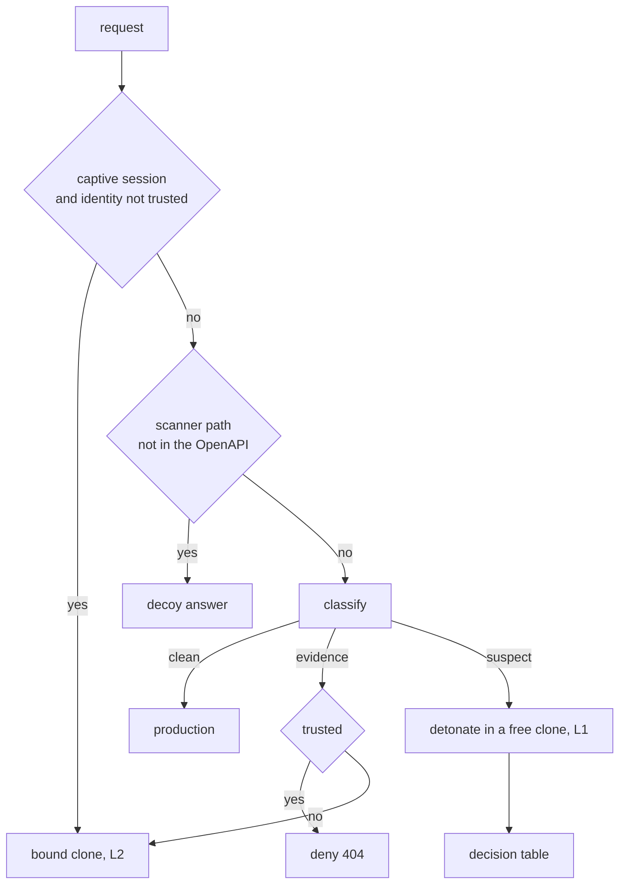

# gateway

## Purpose

The gateway is the L7 reverse proxy in front of the protected app. For every request it classifies the request
from its shape and the caller's identity, detonates the suspect ones in a clone, and routes on the clone's verdict:
to production, to the clone's answer, to a decoy, or to a 404. It also applies the rules posted by the pipeline,
records the traffic, and publishes events to the bus.

It decides by execution, not by score: a request is treated as an attack when an oracle fires in a clone
(see [`shadow/`](../shadow/README.md) and [`sidecar/`](../sidecar/README.md)).

## How it runs

One asyncio process with three uvicorn listeners, started as `python -m gateway` (`gateway/__main__.py`).
`immune up` runs it as the container `immune-<project>-gateway` from `deploy/compose.yaml`.

| Listener | Port in the container | Published by `deploy/compose.yaml` | Used by |
|---|---|---|---|
| data | 8080 (`GW_DATA_PORT`) | `127.0.0.1:<ports.gateway>` | clients |
| admin | 8081 (`GW_ADMIN_PORT`) | `127.0.0.1:<ports.admin>` | fleet, pipeline, CLI |
| clone ingest | 9000 (`GW_INGEST_PORT`) | not published | clones, over the internal clone network |

The container is read-only, runs with all capabilities dropped and `no-new-privileges`, as the host user. It is
attached to the production, clone and control networks (all `internal: true`) and to the `edge` network.
It has no Docker access; clones are created by [`fleet/`](../fleet/README.md), which registers them through
`PUT /_admin/pool`.

## Layout

| File | Role |
|---|---|
| `__main__.py` | Starts the three listeners and handles SIGINT/SIGTERM once for all of them |
| `core.py` | `Config`, `Gateway`: request reading, routing decision, forwarding to prod and clones, upstream switch with drain, persisted state, recording, admin app, ingest app |
| `classifier.py` | `classify()`: reasons and class of a request; `Rule`; `Manifest`; `EnumTracker`; the built-in traversal rule; redaction helpers for the recording |
| `spec.py` | OpenAPI loading (local `$ref`), path-template matching on both readings of the path, per-value schema checks |
| `pool.py` | Clone states and captive sessions: acquire, bind, evict, idle expiry |
| `l0.py` | Fixed list of scanner paths and their deterministic decoy answers |
| `bus.py` | Non-blocking event publisher with a retry buffer |
| `tests/` | Unit tests and a gateway run as a real process against fake prod, clone and bus (`tests/world.py`) |

## Configuration

Environment variables read by `Config.from_env` and `Recorder` in `core.py`. `immune up` sets them through
`deploy/compose.yaml` and the project's secrets file.

| Variable | Default | Meaning |
|---|---|---|
| `GW_HOST` | `0.0.0.0` | Bind address of the three listeners (inside the container) |
| `GW_DATA_PORT` | `8080` | Data listener |
| `GW_ADMIN_PORT` | `8081` | Admin listener |
| `GW_INGEST_PORT` | `9000` | Clone evidence listener |
| `GW_MODE` | `enforce` | Initial mode: `enforce`, `observe` or `passthrough`. An unknown value means `enforce` |
| `GW_AFTERCHECK` | off | `1`, `true`, `yes` or `on` enables the after-check (config key `aftercheck`) |
| `GW_STATE_PATH` | empty | File where upstream, mode and rules are persisted. Empty disables persistence |
| `GW_CAPTIVE_TTL_S` | `900` | Idle time after which a captive session is released |
| `PROD_ADDR` | `127.0.0.1:8000` | Initial upstream `host:port` |
| `PROD_RELEASE` | empty | Release id of the initial upstream |
| `PROD_APP_SECRET` | empty | Secret that verifies production tokens (`auth.kind: immune-token`) |
| `SHADOW_APP_SECRET` | empty | Secret used inside clones. A token signed with it and seen here is a honeytoken |
| `IMMUNE_AUTH` | `{"kind":"immune-token"}` | JSON of the `auth` block of `.immune/config.yaml` (see `immune/auth.py`) |
| `ADMIN_TOKEN` | empty | Required value of `x-admin-token` on the admin listener. Empty refuses every admin call |
| `BUS_URL` | empty | Base URL of the event bus. Empty disables publishing |
| `BUS_TOKEN` | empty | Sent as `x-bus-token` |
| `RUN_ID` | empty | Stamped on every event; also keys the persisted state |
| `OPENAPI_PATH` | empty | OpenAPI document of the app. Missing file or empty value means an empty spec |
| `MANIFEST_PATH` | empty | `manifest.json` of the shadow data (seed uid limit, ownership, canaries, groups) |
| `RECORD_PATH` | empty | Request recording (JSONL). Empty disables recording |
| `RECORD_MAX_MB` | `256` | Size at which the recording rotates to `<RECORD_PATH>.1` (one generation kept) |

With `auth.kind: jwt-hs256` the production secret is read from the variable named by `auth.secret_env`
(`immune/auth.py`, `prod_secret_for`).

Fixed constants in `core.py`: request body limit 10 MiB (`MAX_BODY`), body read timeout 30 s, wait for a free clone
0.3 s (`CLONE_WAIT_S`), production timeout 30 s (connect 3 s), clone timeout 20 s (connect 1 s).

## Behaviour

### Request path



This is `Gateway.handle` in enforce mode. The steps in detail, numbered as in `contracts/README.md` section 6.3:

1. **Read** (`_read`). The body is read in full before anything is forwarded. A request with a non-origin-form
   target gets 400, a body over 10 MiB gets 413, a body not completed in 30 s gets 408. A client that disconnects
   mid-body is dropped: not forwarded, not answered, not recorded. Client headers starting with `x-imm-` are
   removed. The identity is resolved in the same step (`resolve`, `identify`). `auth.kind` decides how: `immune-token` and `jwt-hs256` verify the bearer
   token locally; `introspect` asks production (`GET <auth.path>` with the client's `Authorization` and `Cookie`,
   cached per credential for `auth.cache_s`, default 30 s, 5 s for a negative answer); `none` treats everyone as
   anonymous. Trust is binary: an identity is trusted when `uid <= seed_max_uid` of the manifest. Newer and
   anonymous identities are untrusted.
2. **Session key**. `uid:<n>` for an identified client, else `gwsid:<cookie>`. A missing or malformed `gwsid`
   cookie is minted and set on the response (`HttpOnly; SameSite=Lax`). The `gwsid` cookie is removed from the
   `Cookie` header forwarded to production and clones.
3. **Captive session**. An untrusted identity whose session is captive is served from its clone and never from
   production. For an identified client the cookie session is checked too, so a captive anonymous client stays
   captive after it logs in.
4. **L0**. A path in `l0.SCANNER_PATHS` (or under `/wp-admin/`, `/phpmyadmin/`) that the OpenAPI does not define
   gets a fake answer whose content is derived from a hash of path and session. No production call is made.
5. **Classification** (`classifier.classify`), then the decision below.

### Classification reasons

A request with no reason is `clean`. A request with `honeytoken` or `canary:*` is `evidence`. Any other reason
makes it `suspect`.

| Reason | Fires when | Needs the route in the OpenAPI |
|---|---|---|
| `path:encoded_slash` | The two readings of the path (decode then split, split then decode) route to different operations, or only one of them routes | at least one reading must match an operation |
| `honeytoken` | The bearer token verifies with the shadow secret | no |
| `dup_query:<name>` | A query parameter appears more than once | no |
| `traversal:path` | A `..` path segment under any of the handled encodings (up to 4 decode rounds, overlong UTF-8 forms, backslash) | no |
| `traversal:query.<name>` | A query value contains `../`, ends in `/..` or is `..` | no |
| `schema:<where>.<name>:<kind>` | A value violates its declared schema. `kind` is `type`, `enum`, `bounds`, `length` or `pattern`; `where` is `query`, `path`, `header`, `form` or `json` | yes |
| `schema:json:invalid`, `schema:form:invalid` | The body cannot be parsed as its declared type | yes |
| `grammar:<where>.<name>` | A textual value is outside the safe-default grammar (`immune_contracts/grammar.py`); catch-all path parameters also allow `/` | yes |
| `grammar:query.key`, `grammar:json.key` | A parameter name or JSON key is not `[A-Za-z0-9_-]{1,64}` | yes |
| `owner_scoped:anonymous`, `owner_scoped:untrusted` | The operation is `x-owner-scoped` and the identity is not trusted | yes |
| `owner_scoped:mismatch:<param>` | The operation is `x-owner-scoped`, the identity is trusted and not admin, and the manifest attributes the addressed object to someone else | yes |
| `canary:<param>` | A path parameter equals a canary id of the manifest and the caller is neither its owner nor admin | yes |
| `enumeration` | One session addressed more than 8 distinct parameter tuples on one `x-owner-scoped` template within 30 s | yes |
| `rule:<id>` | An active rule matches (see Rules) | no |
| `scanner` | Assigned by `core.py` to L0 requests | no |
| `captive` | Prefixed by `core.py` for requests of a captive session | no |

Details that change what is caught:

- Routes and rules match on the path decoded once and then split on `/` (what uvicorn and starlette do), and also
  on the path split first and then decoded. A match on either reading counts. `%252F` and `%5C` are never
  separators.
- `x-sensitive` parameters and JSON properties are not inspected at all. In the recording, the `x-sensitive`
  values of path and header parameters, of the query string, of a JSON body and of form fields (URL-encoded or
  multipart) are replaced by `<redacted>`.
- Header parameters are inspected only when the OpenAPI declares them. Cookies are not inspected. File parts of a
  multipart body are ignored.
- Ownership (`classifier._owns`) comes from the manifest: a `group_routes` entry means membership in the group;
  `user_id` is compared with the caller's uid; `<name>_id` is looked up in `ownership["<name>s"]`. An object
  absent from the manifest is not flagged.

### Decision for a suspect request

`Gateway._detonation` runs the request in a free clone in mode L1 (the clone resets itself afterwards) and
decides. "Fail closed" means: a rule matched, or the reason `traversal:path` is present, or any reason starts
with `schema:`, `grammar:`, `dup_query:` or `traversal:`.

| Clone verdict | Identity | Condition | Route | Client receives |
|---|---|---|---|---|
| no clone answered | any | fail closed | `deny` | 404 `{"detail":"Not Found"}` |
| no clone answered | any | otherwise | `prod` | production's response |
| `oracle` | trusted | | `deny` | 404 |
| `oracle` | untrusted | | `shadow_l1` | the clone's response; the session becomes captive |
| `clean` or `inconclusive` | any | reason `traversal:path` present | `deny` | 404 |
| `clean` | any | otherwise | `prod` | production's response |
| `inconclusive` | any | a rule matched | `deny` | 404 |
| `inconclusive` | any | otherwise | `prod` | production's response |

"No clone answered" covers no free clone within 0.3 s and a clone that failed (it is retired; the fleet replaces
it). When no clone was free the gateway also retires the clone of the oldest clone-bound captive session, so the
fleet replaces it and a later detonation finds one. A missing or
unknown verdict header counts as `inconclusive`. A handler exception results in `deny`.

Evidence (`honeytoken`, `canary:*`) is not detonated: a trusted identity is denied; an untrusted one becomes
captive at once and the request is replayed in its L2 clone (deny when no clone can be bound).

### Captive sessions and the clone pool (`pool.py`)

- Clone states: `free`, `busy` (one L1 request), `captive` (bound to one session), `retired`. A retired clone is
  never reused.
- Captivity is lazy. An L1 oracle marks the session captive and releases the clone. The session's next request
  binds a clone, evicting the oldest bound captive when none is free. An evicted session stays captive and binds
  again on its next request.
- A clone serves one request at a time (per-clone lock), so a bound session is serialised on its clone.
- Limits: a global cap of 50000 captive sessions (`Pool.max_sessions`, oldest unbound dropped first) and the idle
  TTL `GW_CAPTIVE_TTL_S`. There is no per-origin cap.
- Requests to a clone carry `x-imm-rid`, `x-imm-mode` and, for an identified client, `x-imm-uid` and `x-imm-role`
  (production tokens do not verify inside a clone). Response headers starting with `x-imm-` are never sent to
  the client.

### Rules

A rule is `{id, method, route, scope, param, grammar, ttl_s, incident}` (`classifier.Rule`). `scope: all` matches
every request on the route. `scope: param` matches when a value of the named parameter (`in`: `path`, `query`,
`header`, `json`, `form`) falls outside the rule's grammar. `method` may be `*`; a `GET` rule also covers `HEAD`.
Rules are never scoped to an IP address, a fingerprint or a user agent.

A rule hit does not block by itself. It makes the request suspect and fail closed: the request is detonated, and
it reaches production only when the clone says `clean`. A rule is therefore as strong as the oracle behind it.
Rules apply to every identity, trusted ones included. They expire after `ttl_s` and are removed by the pipeline
when the fix is deployed.

### Modes

| Mode | Behaviour |
|---|---|
| `enforce` | As described above |
| `observe` | Classifies and detonates like enforce, answers every request from production, never evicts or captures. The decision enforce would have taken is recorded as `would_route`, and events carry `observe: true` |
| `passthrough` | Classifies for the record and forwards everything to production. No detonation |

`immune mode` switches between `observe` and `enforce`. `passthrough` is reachable only through `GW_MODE` or
`POST /_admin/mode`.

### After-check

Off by default (`GW_AFTERCHECK`). When on, in enforce mode, each distinct clean request that production already
answered is replayed once per release in an L1 clone by a single background worker (queue of 256, 2 s wait for a
clone). If an oracle fires, the evidence opens an incident as for any detonation, the request is marked in the
recording so it stays out of the legitimate corpus, and an untrusted session becomes captive from its next
request.

### Forwarding to production

- The request target is sent byte for byte as the client sent it; dot segments are not resolved.
- Hop-by-hop headers are removed in both directions. Responses are fully buffered; `content-encoding`, `date`
  and `server` are dropped.
- A connection error before anything was sent is retried once for any method. A broken pooled connection is
  retried once for `GET`, `HEAD` and `OPTIONS` only. A timeout answers 504, any other failure 502.
- A request that cannot be put on the wire as sent answers 400 and is not counted as a production error.
- `POST /_admin/upstream` closes the gate for new production requests, waits up to 30 s for in-flight ones,
  switches, resets the statistics and reopens.

### Persisted state

With `GW_STATE_PATH` set, the upstream, the mode and the active rules (with their expiry times) are written to
that file on every change and restored at start when the file's `run_id` equals `RUN_ID`. `immune up` points it
at `<runtime>/stack/gateway-state.json`. Captive sessions, the clone set, the production log, enumeration counters
and statistics are in memory only; the fleet registers the clone set again.

### Admin API (port 8081)

Every route requires `x-admin-token` (constant-time comparison); otherwise 403.

| Route | Purpose |
|---|---|
| `GET /_admin/health` | Mode, upstream, pool counts |
| `GET /_admin/pool`, `PUT /_admin/pool` | Read or replace the full clone set `{clones:[{id, addr, key, release}]}` |
| `GET /_admin/rules`, `POST /_admin/rules`, `DELETE /_admin/rules/{id}` | Active rules; add one or a list (201, or 422 when invalid); remove |
| `GET /_admin/upstream`, `POST /_admin/upstream` | Read or switch the upstream `{addr, release}` |
| `GET /_admin/sessions` | Captive sessions |
| `POST /_admin/mode` | `{mode: enforce|observe|passthrough}` |
| `GET /_admin/prodlog?rid=` | `{forwarded, status}` for one request id (last 50000 requests) |
| `GET /_admin/stats` | Counters since the last upstream switch: production requests, 5xx, connection errors, by class, by route, after-check, events dropped |
| `POST /_admin/reset` | Releases every captive session, removes every rule, clears counters. Does not truncate the recording |

### Clone ingest (port 9000)

`POST /_clone/evidence`: a clone pushes its evidence, signed with HMAC-SHA256 of the body under the clone's key
(`immune_contracts/wire.py`). An unknown clone or a bad signature gets 403. The gateway adds the session and uid
of the request and publishes `oracle.fired`.

### Recording and events

- One JSON line per answered request in `RECORD_PATH`: identity, method, path, query, headers, base64 body,
  class, reasons, route, verdict, status, latency, release, mode. `Authorization`, `Cookie` and
  `Proxy-Authorization` values and every `x-sensitive` value (path, header, query, JSON, form fields) are redacted.
- Events published: `request.classified`, `request.routed`, `oracle.fired`, `session.captured`,
  `session.released`, `rule.active`, `rule.expired`, `upstream.switched`. Publishing never blocks a request.
  `request.*` events are dropped when the bus fails; the others are retried for 120 s (at most 2000 kept). The HTTP
  timeout is 1.0 s, connect 0.3 s.

Wire-level detail (headers, schemas, event payloads) is in [`contracts/`](../contracts/README.md).

## Tests

```
.venv/bin/pytest gateway/tests -q
.venv/bin/pytest acceptance/wp3_gateway -q
```

Neither needs Docker or the LLM. `gateway/tests` runs the gateway as a subprocess against in-process fakes;
the acceptance suite does the same with the fixture app in `acceptance/fixture/`.

## Limits

- An `inconclusive` verdict (the clone answered 401, 404 or 5xx) without an active rule fails open to production.
- `gwsid` is supplied by the client and unsigned. Captivity of an anonymous client holds only while the client
  keeps sending the cookie.
- The built-in traversal rule recognises `..` segments only. Absolute paths and other file-access tricks depend
  on the schema, the grammar and the oracles.
- A route missing from the OpenAPI classifies clean unless a rule, the built-in traversal rule, a duplicated query
  parameter or a honeytoken applies. A scanner path gets the L0 decoy.
- `x-sensitive` fields, undeclared headers and cookies are not inspected.
- Clones run the seed snapshot. An object created in production after the seed is a 404 in the clone, hence
  `inconclusive`.
- Identity trust is a seed-uid threshold. There is no grading by account age, MFA or payment history.
- L0 is a fixed list of paths with static decoys. There is no generated pagination and no slow drip.
- Captive sessions have a global cap and an idle TTL only.
- The honeytoken is the only decoy credential: a token signed with the shadow secret. No other credentials are
  planted.
- The ownership lookup assumes the manifest key is the parameter name without `_id` plus `s`.

The full list across components is in [`docs/limites.md`](../docs/limites.md).
