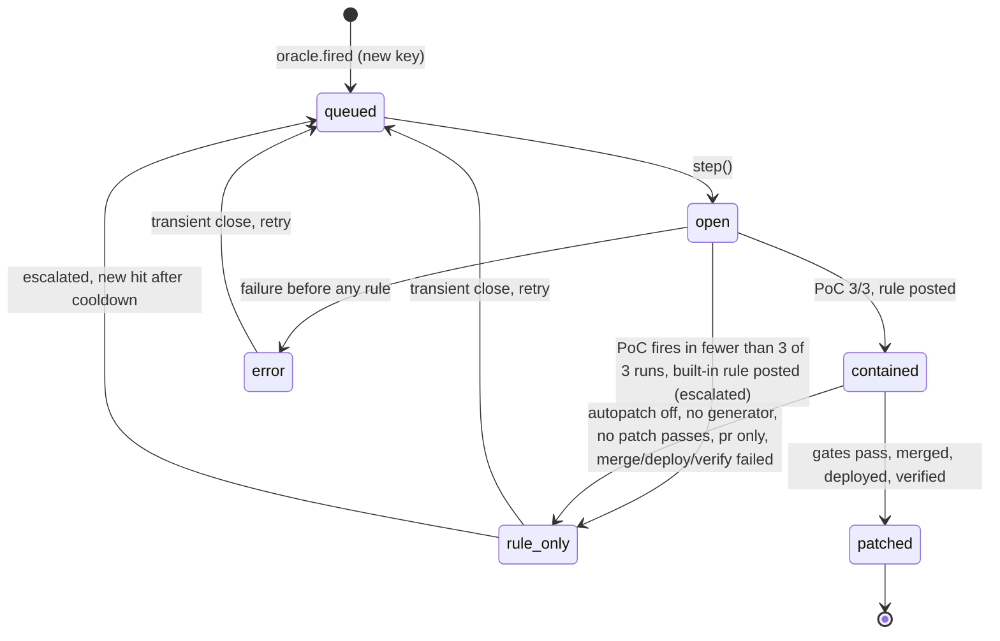

# pipeline

## Purpose

The pipeline turns a confirmed detonation into a deployed fix. It follows the event bus, opens one incident per
`oracle.fired` event, reproduces it, posts a containment rule to the gateway, asks the patch generator for a diff,
judges the diff with five gates, opens a pull request, merges it, deploys the new release through the fleet and
verifies the result through the gateway. After a fix it audits the rest of the API for the same class of defect.

The pipeline never executes application code in its own process. Application code runs only in runner containers
(`runner.py`) or, for `app.runtime: generic`, in throw-away clone triples (`generic.py`).

Related documents: gate reference in [`../docs/validaciones.md`](../docs/validaciones.md), architecture in
[`../docs/arquitectura.md`](../docs/arquitectura.md), measured results in
[`../docs/resultados.md`](../docs/resultados.md), limits in [`../docs/limites.md`](../docs/limites.md), operation in
[`../docs/operacion.md`](../docs/operacion.md), wire-level contracts in [`../contracts/`](../contracts/).

## How it runs

A host process, one per project. `immune up` starts it under `immune.supervise`, as the transient systemd user
unit `immune-<project>-pipeline` or, on a host without a systemd user manager, as a detached process
(see [`../docs/operacion.md`](../docs/operacion.md)). It listens on no port: it is a client of the bus
(dashboard), of the gateway admin API and of the fleet, and it starts Docker containers for the runner.

```
python -m pipeline                   # follow the bus, process incidents one at a time, forever
python -m pipeline --once            # process what is queued, exit after --idle seconds without work (default 3)
python -m pipeline --replay EV.json  # enqueue a saved oracle.fired event (repeatable; no bus follow), process, exit
python -m pipeline --status          # print the persisted state summary as JSON
python -m pipeline.selftest          # gate self-test (needs Docker); see "Self-test"
python -m pipeline.dryrun [EV.json]  # whole flow with a fake bus, gateway and fleet and a real runner
```

`--replay` accepts one event object or `{"events": [...]}`. While the file `PAUSE` exists in the state directory
(`<runtime>/pipeline/PAUSE`) no new incident and no audit starts; the incident in progress finishes.

## Layout

| File | Role |
|---|---|
| `__main__.py` | Entry point: builds the `Pipeline` (or `ExternalPipeline` for the generic runtime), main loop |
| `config.py` | `Config.from_env`: every URL, path and limit |
| `state.py` | Persistent state (`state.json`), atomic writes |
| `bus.py` | `Publisher` (bus + local `events.jsonl`), `Follower` (SSE), `history` |
| `clients.py` | HTTP clients of the gateway admin API and of the fleet |
| `incident.py` | `oracle.fired` evidence to incident: class, route, parameter, sink, dedupe key |
| `openapi.py`, `reqs.py` | OpenAPI lookup and request manipulation helpers |
| `poc.py` | Regression case (`contracts/schemas/poc.schema.json`) and built-in mutations |
| `rules.py` | Rule finalisation and the built-in rule |
| `orchestrator.py` | `Pipeline`: the incident flow, upkeep, class audit scheduling |
| `gates.py` | `Validator`: reproduction and the five gates |
| `policy.py` | Gate `policy` for Python sources (AST comparison) |
| `properties.py` | Gate `properties` (per-class positive properties) |
| `diffs.py` | Unified diff parsing and application to a temporary copy of a release |
| `runner.py`, `runner_entry.py`, `jobshape.py` | Host side and container side of the runner; shared result shaping |
| `verify.py` | Post-deploy verification (runner and gateway) |
| `repo.py` | Repository targets: `LocalRepo`, `GitHubRepo` |
| `audit.py`, `corpus.py` | Class audit and the corpus of confirmed values |
| `external.py`, `generic.py`, `generic_patch.py` | Generic runtime: flow variant, judge on clone triples, lexical policy, patch generator |
| `extfix.py` | Patch stage of the reproduction-only mode, driven by a target file (`EXTERNAL_TARGET`); see "External patch stage" |
| `selftest.py`, `fixes.py` | Gate self-test and its catalogue of hand-written fixes |
| `dryrun.py`, `fakes.py`, `stub_patcher.py` | Dry run with fakes; stand-in for the patch generator in tests |

## Configuration

Project facts come from `.immune/config.yaml` (schema in [`../contracts/product.md`](../contracts/product.md)):
`app.release_paths`, `app.source_dirs`, `app.runtime`, `tests.command`, `scenarios`, `autopatch`,
`repo.target` (`local` or `github`), `repo.github`, `repo.t0_tag` (default `immune-t0`),
`audit.enabled` (default true for `python-asgi`, false otherwise), `audit.max_jobs` (40), `audit.max_seconds` (120).
The file is re-read at the start of every incident, so `autopatch` can change while the pipeline runs.

Environment variables read by `config.py` (defaults in parentheses):

| Variable | Meaning |
|---|---|
| `RUNTIME_DIR` | Runtime directory (the project's `runtime_dir`) |
| `REPO_DIR` | Immune checkout mounted into runners (this repository) |
| `RUN_ID` | Run identifier (file `run_id` in the runtime directory, else `dev`) |
| `PIPELINE_STATE_DIR` | State directory (`<runtime>/pipeline`) |
| `PIPELINE_BUS_URL`, else `FLEET_BUS_URL` | Bus URL (`http://127.0.0.1:<ports.dashboard>`) |
| `BUS_TOKEN`, `ADMIN_TOKEN`, `PROD_APP_SECRET` | Secrets; when unset they fall back to the placeholders in `deploy/demo.env` |
| `GATEWAY_ADMIN_URL`, `GATEWAY_URL` | Gateway admin and data URLs (`http://127.0.0.1:<ports.admin>`, `<ports.gateway>`) |
| `FLEET_URL`, else `FLEET_PORT` | Fleet URL (`http://127.0.0.1:<ports.fleet>`) |
| `OPENAPI_PATH_HOST`, `MANIFEST_PATH_HOST`, `RECORD_PATH_HOST` | OpenAPI file, `data/manifest.json`, `recordings/requests.jsonl` |
| `PIPELINE_BASE_RELEASE` | Release used before the first deploy (`t0`) |
| `PATCHER_MODULE` | Patch generator module (`patcher`) |
| `SCENARIOS_MODULE` | Legit scenarios module (the `scenarios` key of the project; empty means recorded requests) |
| `REPO_TARGET` | Overrides `repo.target`. `repo.make_target` accepts `local`, `scratch` and `official`; the last two both select `GitHubRepo` and behave the same (`repo.target: github` maps to `official`) |
| `GITHUB_REPO`, `REPO_TARGET_DIR` | GitHub `owner/name` (`repo.github`); local repository path (`<runtime>/repo`) |
| `RUNNER_IMAGE` (`immune-base:1`), `RUNNER_PREFIX` (`immune-<project>-runner`) | Runner image and container name prefix |
| `RUNNER_TIMEOUT_S` (240), `RUNNER_MEMORY` (`1g`), `RUNNER_CPUS` (`2`), `RUNNER_PIDS` (256) | Runner limits |
| `RUNNER_APP_NOW` (`1767225600`), `SEED` (1) | Frozen clock and seed number of every runner job |
| `PIPELINE_MAX_ATTEMPTS` (3) | Patch attempts per incident |
| `PIPELINE_PATCHER_TIMEOUT_S` (600) | Limit of one `propose` call |
| `PIPELINE_HTTP_TIMEOUT_S` (5), `PIPELINE_DEPLOY_TIMEOUT_S` (300), `PIPELINE_VERIFY_WAIT_S` (8) | HTTP, deploy and verification waits |
| `PIPELINE_VERIFY_CAPACITY_RETRIES` (4), `PIPELINE_VERIFY_CAPACITY_WAIT_S` (3) | The gateway check is repeated this many times, this many seconds apart, while the gateway denies it for want of a free clone (`verdict: no_clone`); that denial says nothing about the code. After the last try the result is "not verified, the code was not judged" |
| `PIPELINE_RULE_TTL_S` (unset) | `ttl_s` given to a rule whose `ttl_s` is missing or `null`, the patcher-derived rule included. Unset or `0`: `ttl_s` is `null` and the rule does not expire |
| `PIPELINE_REOPEN_COOLDOWN_S` (300) | Wait before a closed incident can reopen (see "Intake and deduplication") |
| `PIPELINE_RETRY_COOLDOWN_S` (60), `PIPELINE_MAX_RETRIES` (5) | Retry of transient closes |
| `POLICY_MAX_LINES` (120), `POLICY_MAX_FILES` (4) | Size bounds of the `policy` gate |
| `PIPELINE_APP=external`, `REPRO_URL` | Select `ExternalPipeline` and its reproduction-only mode (see "Generic runtime") |
| `EXTERNAL_TARGET` | Path of a target file (YAML) for the patch stage of the reproduction-only mode; unset means no patch stage (`__main__.build`) |
| `JUDGE_BASE_RELEASE` (`t0`) | Release whose app image the judge triples run (`generic.JudgeRunner`) |
| `PIPELINE_LOG_LEVEL` (`INFO`), `PIPELINE_LOG_HTTP` | Logging |

## Behaviour

### Intake and deduplication

`bus.Follower` reads `GET /events/stream?since=<last seq>` and reconnects with a backoff of 0.5 s to 10 s. The last
sequence number is persisted, so a restart resumes where it stopped; a `reset` message from the bus sets it to 0.
It sends `x-bus-token` so the bus returns events unredacted.

Each `oracle.fired` event becomes an incident skeleton (`incident.build`):

- Class: the first oracle kind present in the order `sql`, `file`, `owner`, mapped to `sqli`, `traversal`, `idor`.
  Any other kind gives class `other`, for which no positive property exists, so no patch can pass.
- Route: the OpenAPI template matching the request, else the request path made safe (`safe_route`).
- Parameter (`derive_param`): for `sql` the parameter named by the oracle; for `file` the request input contained in
  the opened path; otherwise the last path parameter (one listed in the manifest's `canaries` first), else a numeric
  query parameter.
- Sink: the innermost stack frame; empty when the evidence has no stack (generic runtime).
- Dedupe key: `<oracle kind>|<METHOD>|<route>|<in>:<name>`.

The skeleton also carries `anon`: true when the oracle kind is `owner` and the request had no identity (`uid` null),
that is, a missing-authentication defect rather than an authenticated user reaching another owner's object.

A second event with a known key only increments `hits`. A closed incident reopens only if
`PIPELINE_REOPEN_COOLDOWN_S` has passed and it is one of: `rule_only` with `outcome_detail: escalated`; `error` with
its retries spent; `not_reproducible` (no current code path closes with this outcome; it is honoured for state files
written by earlier versions). `patched` incidents and every other `rule_only` incident never reopen. Incidents wait in a persistent queue and are processed one at a time.

### Incident flow



`Pipeline._flow` in `orchestrator.py`:

1. **Open.** Publishes `incident.opened`. The base release is the one the fleet reports in production, else the last
   known one, else `t0`.
2. **Reproduce.** `poc.build` writes the regression case: the captured request with the identity kept as `uid`/`role`
   (the attacker's `Authorization` header is dropped) and, when the evidence carries one, the pre-request database
   state. `Validator.reproduce` runs the PoC three times on the unpatched release. A run counts when it fires the
   incident's oracle kind and, if the incident has a sink file, that file is in the event's stack. With fewer than
   3 of 3 (0 of 3 included) the incident is escalated (`Pipeline.escalate`): the built-in rule is posted, no fix is
   attempted, and the incident closes `rule_only` with `outcome_detail: escalated`. The oracle did fire on the live
   request, so the point is contained; without a PoC that fires every time no fix can be validated. The sink check is skipped when the incident has no sink file
   (generic runtime). The same job also runs the variants: built-in mutations (`poc.mutate`), the requests returned by
   `patcher.variants` (60 s limit) and values of the class corpus. Duplicates of the PoC or of each other are dropped.
   Only variants that fire the oracle on the unpatched release are counted. Publishes `poc.ready`.
3. **Contain.** `patcher.derive_rule` (30 s limit) proposes a rule; `rules.finalize` sets its incident, gives it the id
   `rule-<incident>` when it has none and, when it has no `ttl_s`, sets `ttl_s` to `PIPELINE_RULE_TTL_S` or to `null`
   (no expiry) when that variable is unset. It requires the incident's route and method, adds `identity: untrusted`
   to a `scope: all` rule of an `anon` incident, and validates the rule against
   `contracts/schemas/rule.schema.json`. If the rule is missing or invalid the built-in rule
   (`rules.default_rule`) is used: `scope: all` for `idor` or when there is no usable parameter (with
   `identity: untrusted` for an `anon` incident, so only untrusted identities are detonated); otherwise
   `scope: param_present` (every request carrying the parameter is detonated) with `grammar.SAFE_DEFAULT`,
   `PATH_SAFE` for a catch-all path parameter, or `[0-9]{1,9}` for an integer parameter. The rule is posted to the
   gateway (`POST /_admin/rules`). Rule semantics are in [`../gateway/README.md`](../gateway/README.md).
4. **Autopatch level.** `autopatch: off` closes the incident `rule_only` here. Without `tests.command` the level is
   capped at `pr` (`immune.config.Config.effective_autopatch`).
5. **Fix loop.** Up to `PIPELINE_MAX_ATTEMPTS` calls of `propose(release_dir, incident, feedback, attempt)`, each in a
   thread with `PIPELINE_PATCHER_TIMEOUT_S`. Each attempt publishes `patch.attempt` (with `source`) and `patch.diff`.
   The diff is applied to a temporary copy of the base release and judged by the gates. When an attempt is rejected,
   the line `Attempt N was rejected by the <gate> gate: <detail>` is appended to the feedback of the next call. The
   reported `source` is `llm`, `fallback` or `unknown`; a missing or unexpected value is never reported as `llm`.
6. **Pull request.** The change is opened as soon as the `policy` gate passes (`pr.opened`); later attempts are
   further commits on the same branch. Every gate result is reported on it. If no attempt passes, the change is
   abandoned and the incident closes `rule_only`.
7. **Cap.** With `autopatch: pr`, or when a gate recorded a cap (see below), a comment is left on the pull request and
   the incident closes `rule_only` with detail `pr_open`. It is not merged.
8. **Merge and release.** The change is merged (`pr.merged`) and the merge commit is materialised as
   `<runtime>/releases/<sha[:12]>` (only `app.release_paths`; links and escaping paths in the archive are refused).
9. **Deploy.** `POST /deploy {release}` on the fleet, at most three tries when the fleet restarts mid-deploy. If the
   deploy fails or rolls back, the merge is reverted on the base branch and the incident closes `rule_only`.
10. **Verify.** The rule is deleted, then two checks run (`verify.py`):
    - runner: the PoC and every counted variant fire no oracle on the deployed release;
    - gateway: the captured request is sent through the gateway from a fresh session with the same trust class
      (a new cookie, or a freshly minted token; with `auth.kind: introspect` a new account registered through the
      app's own register and login routes found in the OpenAPI). It must be routed to `prod` according to the bus or
      the recording, and the gateway's `GET /_admin/prodlog` must answer `forwarded: true` for that request. A
      missing or unreadable answer is a failed verification. If the captured path value is a canary, another seed id
      is used, because the gateway diverts canaries whatever the code does. With `auth.kind: introspect` and an
      `auth.login` block in the project config, a seeded attacker is verified by logging a seeded account in through
      the gateway (`verify.login_session`; credentials from the environment variables named by `user_env` and
      `password_env`, else `default_user` and `default_password`); without `auth.login` a seeded attacker under
      `introspect` cannot be verified through the gateway and the check fails.

    Publishes `verify.result`. If either check fails the rule is posted again and the incident closes `rule_only`.
    Otherwise it closes `patched`.

`incident.closed` carries `seconds_to_rule` and `seconds_to_patch`, both measured from the timestamp of the
`oracle.fired` event, so queue time is included.

### Outcomes

| Outcome | Meaning |
|---|---|
| `patched` | A release with the fix is in production and both verifications passed |
| `rule_only` | A rule was posted and stays active; no fix was deployed |
| `error` | The flow failed before any rule was posted; nothing contains the incident |
| `not_reproducible` | Not produced by the current code. The value remains in `immune_contracts/events.py` and in the reopen check for state written by earlier versions |

`incident.closed` also carries `outcome_detail` when the flow set one:

| `outcome_detail` | With outcome | Meaning |
|---|---|---|
| `escalated` | `rule_only` | The PoC fired in fewer than 3 of 3 replays. Built-in rule posted, no fix attempted, no class audit; a person decides. A new hit after the cooldown reopens it |
| `autopatch_off` | `rule_only` | `autopatch: off` |
| `pr_open` | `rule_only` | The pull request is open and was not merged (autopatch `pr` or a gate cap) |
| `transient` | `rule_only`, `error` | Closed for a reason that may not hold later; retried by `retry_transient` |

An unexpected exception closes the incident `rule_only` if a rule was posted, else `error`; the loop continues.

Upkeep runs every 20 s while idle (`Pipeline.maintain`):

- `keep_rules`: for every `rule_only` incident, the rule is posted again when the gateway lost it. A rule with a
  `ttl_s` is also posted again when less than a quarter of it remains; a rule without one never expires.
- `retry_transient`: an incident closed for a transient reason (generator unavailable or no proposal in any attempt,
  repository target unavailable, merge failed, fleet unreachable, unexpected exception) is queued again after
  `PIPELINE_RETRY_COOLDOWN_S` x 4^n, capped at one hour, at most `PIPELINE_MAX_RETRIES` times.

### The five gates

`gates.GATES = ("policy", "properties", "poc", "tests", "legit")`, run in this order by `Validator.validate`. An empty
diff or a diff that does not apply is rejected before any gate (reported under `policy`). The first failing gate
stops the attempt. A gate that raises counts as failed. Each result is published as `gate.result` and its `detail` is
the feedback for the next attempt. The reference, including what each gate does not catch, is
[`../docs/validaciones.md`](../docs/validaciones.md).

| Gate | Where | What it requires | Skipped or soft-fails |
|---|---|---|---|
| `policy` | host, no app code runs | See below | Never |
| `properties` | runner, base and patched release | The positive property of the class | Never; fails when it cannot build its cases |
| `poc` | runner, patched release | The PoC and every counted variant fire no oracle of any kind | Never |
| `tests` | runner, patched release | `tests.command` exits 0 | Without `tests.command`: reported as skipped, caps autopatch at `pr` |
| `legit` | runner, base and patched release | Legitimate behaviour identical before and after, patched endpoint covered | Missing coverage soft-fails in two cases (below), caps autopatch at `pr` |

**policy** (`policy.check`). Compares the ASTs before and after of each changed file. Only existing `.py` files under
`app.source_dirs` may change: no created, deleted or renamed files, no mode or binary changes, no symlinks; at most
`POLICY_MAX_LINES` changed lines and `POLICY_MAX_FILES` files. It rejects: new imports; new uses of dynamic code,
process, network or environment access and `getattr` with a computed, private or dangerous name; new file access
with a literal absolute path and new string constants naming a system directory; new reads of request data and new
handler parameters; new route handlers; a test of a value against a literal the app did not already test against
(comparisons, membership, lookups in dict, set or list literals, `match` cases, names the patch binds to such
literals); fewer 401/403 checks in a function; high-entropy string constants; a syntax error after the patch.
It is a heuristic over syntax and does not follow data flow; the constructs it misses are listed in the module
docstring of `policy.py` and in [`../docs/validaciones.md`](../docs/validaciones.md).

**properties** (`properties.py`). Derived from the incident, the shadow profile and the seed manifest; nothing names
an endpoint.

- `sqli`: the structure of the executed statements (literals normalised with `sqlparse`) is identical for the 14
  inputs of `SQL_META` and the two benign values of `SQL_BENIGN`, the status does not change, and `O'Brien` reaches
  the database intact. It fails if a benign value executes no statement or never reaches one.
- `traversal`: the 14 inputs of `TRAVERSAL` open nothing outside the allowed roots, and every legitimate file of the
  unpatched release (every file under the roots, by every relative suffix) returns identical bytes. It fails if no
  legitimate value is found.
- `idor`: an identity by resource matrix. The owner gets 2xx with only own data; another seed user and a new user get
  403 or 404 with no foreign data; the anonymous status is unchanged. For a route shared by a group (manifest
  `group_routes`) the matrix is per group: a member gets exactly the unpatched response, non-members get 403 or 404.
  It fails with fewer than two usable resources or groups.

**poc** (`Validator.gate_poc`). The counted variants are the ones that fired on the unpatched release in step 2.

**tests** (`Validator.gate_tests`). Runs `tests.command` with `/bin/sh -c` in the patched release, 600 s limit.

**legit** (`Validator.gate_legit`).

- With a scenarios module: every scenario runs on a fresh production-like seed with a frozen clock, before and
  after. Status and body of every step must be identical, and some step must cover the incident's endpoint and every
  route handler the diff changed. If coverage is missing and the module sets `PARTIAL_COVERAGE = True`, the gate
  soft-fails: the patch is not rejected, autopatch is capped at `pr`. Otherwise missing coverage rejects the patch.
  A scenarios module that cannot be imported fails the gate.
- Without a scenarios module: the most recent clean `GET` requests that the gateway forwarded to production with
  status 200 (at most 200, read from the tail of the recording and its rotated file) are replayed before and after.
  Requests the after-check marked as attacks and requests with redacted query values are excluded. A difference
  rejects the patch. No recorded request, or none covering the patched endpoint, soft-fails and caps autopatch at `pr`.

### Runner

`runner.Runner.run` executes one JSON job in a container and returns its result:

```
docker run --rm -i --name <prefix>-<pid>-<n> --network none --read-only --tmpfs /tmp:rw,size=512m \
  --cap-drop ALL --security-opt no-new-privileges --pids-limit <RUNNER_PIDS> --memory <RUNNER_MEMORY> \
  --cpus <RUNNER_CPUS> --user <uid>:<gid> -w /app \
  -v <REPO_DIR>:/opt/immune:ro -v <release>:/app:ro [-v <project>/.immune:/app/.immune:ro] \
  <RUNNER_IMAGE> python -m pipeline.runner_entry
```

- `runtime/` and `.git` of the Immune checkout, and the project's runtime directory when it lies under `.immune`, are
  covered by empty tmpfs mounts. A `.env` file at the checkout root is masked with `/dev/null`.
- Without `data.seed_command` the stack's synthetic shadow seed is mounted read-only at `/seed` and stands in for
  both databases; production data is never mounted.
- The job carries the project's app facts (`immune.config.Config.facts()`, no secrets), the seed number and the
  frozen clock.
- On timeout the container is killed and the job fails.
- Result line: `@@RESULT@@ <nonce> <json>` on stdout. The nonce is random per run, travels in the job and is removed
  from it before any application code is imported. The host accepts only a line carrying that nonce, so application
  code that prints a result line cannot forge the verdict. Code that inspects the interpreter of its own process
  (frames, `gc`) could still find the nonce; the `policy` gate rejects the constructs that would need.

Job kinds (`runner_entry.JOBS`): `harness` (request sequences through `shadow.harness.Harness`, the judge), `plain`
(requests against the plain app on a production-like seed, recording SQL text with bound parameters and file opens),
`pytest` (`tests.command`), `scenarios`, `replay`.

### Repository targets

`repo.py`. Base branch `run/<run>/base` created from the tag `repo.t0_tag`; fix branch `run/<run>/fix-<incident>`.
Commit messages and the pull request body state the patch source of each attempt. The captured request appears in
the body inside a code fence that the text cannot close.

- `repo.target: local`: a git repository at `<runtime>/repo` created from the `t0` release; pull requests are JSON
  records under its `.git/immune/prs/`.
- `repo.target: github`: the `gh` CLI against `repo.github`. Commits are created through `gh api`, pull requests
  through `gh pr`; each gate is a commit status `immune/<gate>`. If opening or merging fails, the pipeline continues
  on the local target. This path has been exercised only against a simulated `gh` in `tests/test_repo.py`.

### Class audit and corpus

After an incident of class `sqli`, `traversal` or `idor` closes `patched` or `rule_only`, the next loop step audits
the rest of the OpenAPI for that class (`audit.py`), when `audit.enabled`:

- Candidates are derived from schema shape, not from route names: string-shaped query, path and form parameters and
  JSON string leaves for `sqli` and `traversal` (enum, integer, number and boolean schemas are skipped); path
  parameters and integer or `*id` query parameters for `idor`.
- Each candidate is one judge job on a fresh shadow seed against the current release, never against production or
  the live clones. Inputs: the battery of the `properties` gate for the class plus up to 40 corpus values.
  Identity: a legitimate seed user where the route needs one; for `idor` a new user who owns nothing.
- A probe that fires the class oracle becomes an incident with `origin: "audit"` and `parent`, and goes through the
  normal flow. Known dedupe keys are not probed.
- Budget: `audit.max_jobs`, `audit.max_seconds`. One audit per class per release; the audit triggered by an audit
  incident only judges candidates no earlier audit of the class judged.
- Events: `audit.started`, `audit.finding`, `audit.done`.

Corpus (`corpus.py`): once a PoC reproduces, the value of the affected parameter in the PoC and in every counted
variant is appended to `<runtime>/corpus/<class>.jsonl` (deduplicated, at most 500 per class, values up to 1000
characters). Only the value is kept, not the rest of the request.

### Persistence and restart

`state.State` keeps `<runtime>/pipeline/state.json`: last bus sequence, incident counter, current release, incidents,
queue, dedupe keys, pending audits and audit history. Writes are atomic (temporary file, `fsync`, rename). On start,
an incident left `open` is put back at the front of the queue and redone from the start (`resume_interrupted`).
Every published event is also appended to `<runtime>/pipeline/events.jsonl`. An event the bus could not take stays
pending (at most 2000) and is sent before the next one; an event the bus refuses with a 4xx is dropped.

### Generic runtime

For `app.runtime: generic` (or `PIPELINE_APP=external`), `__main__.build` creates `external.ExternalPipeline`:

- Judge mode (no `REPRO_URL`): the same flow, with every runner job executed on an ephemeral triple on its own
  internal Docker network (`generic.Triple`): the database of `database.kind` (`postgres:16-alpine` or the pinned
  MariaDB image, both defined in `immune/dbkind.py`) loaded from the shadow init directory, the app image of
  `JUDGE_BASE_RELEASE` with the release under test mounted read-only over it, one mount per entry of
  `app.release_paths` (`Triple.source_mounts`, so files the image holds outside those paths stay visible), and the
  observer (`immune-sidecar:1`, `SIDECAR_JUDGE=1`, `SYS_PTRACE` only). One triple runs at a time. The source overlay only changes behaviour for
  interpreted languages.
- The `legit` gate's replay of recorded requests (`JudgeRunner.job_replay`) applies the regular expressions listed
  under `legit.normalize` in `.immune/config.yaml` to each response body before comparing: every match is replaced
  by `<normalized>` (per-session values such as CSRF tokens or timestamps). An expression that does not compile is
  skipped. This key is read only here; the runner of the `python-asgi` runtime does not use it.
- The `policy` gate is `generic.check_generic`: the same file and size rules, no test files, no dependency or build
  files, high-entropy strings; `.py` files get every AST check; other sources get lexical checks only (new imports,
  dangerous tokens, computed member access to them, a lower count of 401/403/auth-helper tokens). The token lists
  (`IMPORT_RES`, `DANGER_RE`, `AUTH_RE` in `generic.py`) cover Node, Go, C, Rust, Ruby, Java and PHP names, including
  PHP `include`/`require` and OpenEMR's ACL and CSRF helpers. For non-Python code it does not see value
  special-casing, new routes or new request reads.
- The patch generator is `generic_patch`: the prompt is rendered by `patcher.core.render` (the same template and
  confinement as `patcher`, see [`../patcher/README.md`](../patcher/README.md)). Up to 3 files are editable
  (`generic_patch.locate`): first the release files named by the stack frames of the evidence, innermost first, when
  the clone's tracer recorded any (`stack_frames`, `stack_files`; `shadow.tracer` in the project config); then
  files scored on the route, the parameter and the observed sink. The prompt states whether a call stack was
  recorded or the defect was observed from outside the process. There is no fallback diff.
- Reproduction-only mode (`REPRO_URL` set, used by `labs/grafana-cve-2021-43798/` and
  `labs/scadabr-cve-2026-8602/`): the last request of the PoC is replayed three times against the clone at
  `REPRO_URL` and a run counts when the response header carries the verdict `oracle`. With fewer than 3 of 3 the
  incident is escalated as in the main flow. Otherwise the built-in rule is posted (`patcher.derive_rule` is not
  called), and the incident closes `rule_only` unless `EXTERNAL_TARGET` names a target file, in which case the
  external patch stage below runs.

### External patch stage

`extfix.ExtFix`, used only by the reproduction-only mode with `EXTERNAL_TARGET` set. It patches an application that
lives in its own git repository and is built into a binary. The only target file in the repository is
`labs/grafana-cve-2021-43798/target.yaml`; `ExtFix` is not general: `editable` lists `*.go` files, `g_policy`
checks Go import strings, and `container` and `verify` use Grafana's configuration file names and the container
label `immune.lab=grafana`.

One attempt (`ExtFix.run`, at most `PIPELINE_MAX_ATTEMPTS`):

1. **Workspace.** A detached git worktree of the current release commit of `repo_dir` (branch `immune/base`,
   created from `base_ref`), under `<deploy.runtime>/work/`.
2. **Propose.** `patcher.claude_cli.run` in that worktree; editable files are the non-test `*.go` files under
   `source_dirs`. The prompt (`ExtFix.prompt`) carries the class, route, parameter, the captured request line and a
   description of the oracle event (`describe`). It does not carry `official_ref`. Publishes `patch.attempt`
   (`source: llm`) and `patch.diff`.
3. **Gates**, `extfix.GATES = ("policy", "build", "tests", "poc", "legit")`, each published as `gate.result`; the
   first failure ends the attempt and its detail is fed to the next one.

   | Gate | Requires |
   |---|---|
   | `policy` | Non-empty diff; only non-test files under `source_dirs`; at most `policy.max_files` (2) files and `policy.max_lines` (60) changed lines; no added `"os/exec"`, `"net/http"`, `"unsafe"` or `//go:` |
   | `build` | `sandbox.build` exits 0 and produces `sandbox.artifact`, in a container with `--network none`, `--cap-drop ALL`, the worktree read-only at `/src` and the module cache at `/cache` |
   | `tests` | `sandbox.tests` exits 0 in the same sandbox |
   | `poc` | On a candidate container running the built artifact with the shadow configuration, the last PoC request and the built-in mutations (`poc.mutate`) produce no oracle event: no marker in the response and, when the target has `oracles.config`, no event from the sidecar's observer and tracer attached to the candidate |
   | `legit` | Every path under `legit` returns the same status on the candidate as on the running shadow, and the same body where `compare: body` |

4. **Pull request and merge.** Commit on branch `immune/<run>/fix-<incident>` with the gate results in the message
   (`pr.opened`, URL `local:<branch>@<commit>`), `git merge --no-ff` into `immune/base` (`pr.merged`). The merge is
   refused if the merged tree differs from the tested tree. A record is written to
   `<deploy.runtime>/prs/<incident>.md`: gate table, diff, the generator's notes and, when `official_ref` resolves,
   the upstream diff of the same files for comparison. This is a local git branch and a Markdown file, not a
   GitHub pull request.
5. **Deploy** (`ExtFix.blue_green`; the fleet is not involved). Starts the idle colour with the artifact, waits
   for health, compares the status of every `legit` path between old and new, switches the gateway
   (`POST /_admin/upstream`), then polls `GET /_admin/stats` for `deploy.watch_s` (20): any `prod_5xx` or
   `prod_conn_errors` switches back and removes the new container. On success the old colour is removed and the
   shadow container is restarted on the same artifact. Publishes `deploy.started` and `deploy.done`.
6. **Verify** (`ExtFix.verify`). The last PoC request is sent to production directly and through the gateway;
   neither response may contain a secret read from the production `grafana.ini`. Publishes `verify.result`.

Outcome `patched` deletes the rule. A failed deploy, a failed verification or no passing attempt closes `rule_only`
with the rule active. Differences from the five gates of the main flow: no `properties` gate, the `policy` gate is
a size, path and string check, and `legit` compares a fixed list of paths.

## Self-test

`python -m pipeline.selftest` needs Docker and the runner image. It detonates every documented exploit of the demo
shop's answer key (`docs/demo/respuestas/tienda.md`, outside every release path) in the harness and derives
incidents from the evidence; the three recorded live events in `tests/fixtures/` must derive to the same keys. Then:

- the seven hand-written diffs in `patcher/fallbacks/` must each pass the five gates;
- the 15 inadequate fixes of `fixes.CATALOGUE` must each be rejected by the stated gate (policy 7, properties 5,
  poc 1, tests 1, legit 1). The catalogue's three adequate fixes are checked by `tests/test_policy_bypass.py`.

It prints a table and exits 0 only if every expectation holds. These are hand-written fixes for the demo shop, not
LLM outputs. Environment: `SELFTEST_RELEASE`, `SELFTEST_JOBS` (3), `SELFTEST_ONLY`, `FALLBACK_DIR`,
`SELFTEST_ANSWER_KEY`. The recorded run is in [`../docs/resultados.md`](../docs/resultados.md).

## Tests

```
.venv/bin/pytest pipeline/tests -q
```

Run from the repository root. Units (incident derivation, policy, diffs, rules, bus, state), the orchestrator with a
scripted validator and HTTP fakes, the local repository target, the GitHub target with a simulated `gh`, the generic
policy, the external patch stage's target loading, policy gate, prompt and published event types
(`tests/test_extfix.py`, no
Docker, no LLM) and the audit run without Docker. `tests/test_integration.py` uses real runner containers and is skipped
when Docker or `immune-base:1` is unavailable. No test in this directory calls the LLM: `stub_patcher.py` stands in
for the patch generator (`STUB_PATCHER_PLAN` selects a fix of `fixes.py` per attempt).

## Limits

- The `policy` gate is a heuristic over syntax; a semantic backdoor that needs no new literal, import or request
  read passes it. The other four gates judge behaviour on the cases they run, not on all inputs.
- One model proposes and the gates decide. There is no second reviewer model.
- The legit corpus is what is configured: scripted scenarios, or recorded clean `GET` requests. Behaviour not
  exercised by either is not compared.
- The runner nonce resists printed forgeries, not introspection of the interpreter.
- Incidents are processed one at a time; a long patch attempt delays the others. Their rules are posted only when
  their turn comes.
- An incident whose PoC fires in fewer than 3 of 3 replays gets the built-in rule and no fix
  (`outcome_detail: escalated`). Nothing in the pipeline notifies a person: the escalation is the `incident.closed`
  event and the incident's `reason`. A request that fired an oracle once for a reason unrelated to its content
  therefore leaves a rule active until someone removes it.
- Rules carry no TTL unless `PIPELINE_RULE_TTL_S` is set: a rule of a `rule_only` incident stays until a fix is
  verified or the rule is deleted through the gateway admin API.
- The external patch stage (`extfix.py`) is specific to the Grafana lab and has no `properties` gate.
- Classes other than `sqli`, `traversal` and `idor` get a rule but no patch.
- GitHub pull requests were exercised only against a simulated `gh`.
- For the generic runtime: no sink check in reproduction, lexical policy, no fallback diff, and the class audit is
  off by default.

The full list is in [`../docs/limites.md`](../docs/limites.md).
