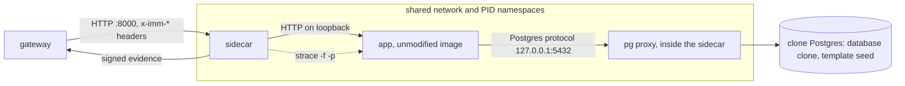

# sidecar

## Purpose

The sidecar provides the oracles for an application that cannot be instrumented in process: any language, run
unmodified from its own image (`app.runtime: generic`). It sits next to the app inside each shadow clone,
observes it from outside (system calls through `strace`, SQL through a PostgreSQL wire proxy, the response
body) and gives the gateway the same per-request verdict as the in-process wrapper in
[`shadow/`](../shadow/README.md).

This directory also holds `sidecar/marker`, a separate and much simpler proxy whose only oracle is a marker in
the response body. Only the Grafana lab uses it.

## How it runs

```
python -m sidecar --config /cfg/sidecar.json
```

One asyncio process (uvicorn) in the image `immune-sidecar:1` (`deploy/Dockerfile.sidecar`: the base image plus
`strace` and `procps`). In a running stack the fleet starts one sidecar container per clone, named
`<prefix>-clone-<n>-obs`, sharing the app container's network and PID namespaces and holding `SYS_PTRACE` as
its only capability (`fleet/generic.py`). The pipeline starts the same image for its ephemeral validation
clones (`pipeline/generic.py`).



Ports: the wire protocol on `listen_port` (8000), the app on `app_port` on loopback, the Postgres proxy on
`postgres.listen` (127.0.0.1:5432). The wire protocol (headers, verdicts, evidence) is specified in
[`contracts/README.md`](../contracts/README.md).

Command-line flags (`main` in `server.py`): `--config` (default `$SIDECAR_CONFIG`), `--host`, `--port`,
`--app-port`, `--mode attach|launch`, `--no-trace` (no tracer: overhead measurement only, the `file`, `proc`
and `net` oracles are off), `--log-level` (default `$SIDECAR_LOG_LEVEL`, else `info`), and after `--` the app
command for launch mode.

## Layout

| File | Role |
|---|---|
| `server.py` | `Sidecar`: start-up, warm-up, one request end to end, verdict, evidence push, L1 database reset; ASGI front end; CLI |
| `tracer.py` | Starts `strace` (attach or launch), reads its output on a thread, finds the app's processes |
| `strace.py` | Parser of `strace` output and classification of each call into an observation |
| `observer.py` | Request window, warm-up allowlists, `file`/`proc`/`net`/`owner` oracle rules |
| `pgproxy.py` | PostgreSQL wire proxy and `StatementTracker` (which statements executed) |
| `pgclient.py` | Minimal asyncio Postgres client for the sidecar's own work (database reset, `ensure_user`) |
| `constants.py` | String literals of the app's source and executables, for the SQL taint check |
| `identity.py` | Identity translation, markers and public paths from a profile or a command |
| `http1.py` | Minimal HTTP/1.1 client to the app (raw response bytes, `Connection: close`) |
| `config.py` | Config file loading |
| `marker/` | The response-marker proxy (`python -m sidecar.marker`) |
| `examples/` | Fixture apps for the tests: `node/` (Node `http` + `pg`), `c/` (statically linked C), `pyhttp/` (stdlib Python, launch mode) |
| `tests/` | Unit and Docker integration tests; `tests/bench.py` is a measurement script, not a test |

## Configuration

A JSON or YAML file (`sidecar/config.py`). A product config with `app:` and `sidecar:` sections is also
accepted: `app.port`, `app.health`, `app.allowed_file_roots`, `app.command`, `app.source_dirs` and
`shadow.profile` map to the keys below.

| Key | Default | Meaning |
|---|---|---|
| `listen_host`, `listen_port` | `0.0.0.0`, 8000 | Where the sidecar serves the wire protocol |
| `app_host`, `app_port` | `127.0.0.1`, 3000 | The app |
| `health` | `/health` | Health path, used for readiness and warm-up |
| `mode` | `attach` | `attach` or `launch` |
| `command` | `[]` | Launch mode: the app command |
| `target_pid` | none | Attach mode: anchor process (default PID 1 of the shared namespace) |
| `allowed_file_roots` | `[]` | Paths, as the app sees them, that the app may open |
| `source_dirs` | `[]` | App source directories scanned for string literals |
| `scan_executable_max_mb` | 32 | Size limit for scanning the app's executables for strings |
| `warmup_paths` | `[]` | Extra benign GETs at start-up |
| `warmup_rounds` | 2 | How many times the warm-up requests are sent |
| `grace_ms` | 30 | How long observations still count after the app's response |
| `request_timeout_s` | 30 | Timeout of the request to the app |
| `profile` | none | Python module name or `.py` path with identity hooks |
| `identity_command` | none | Shell command that prints the app credentials |
| `public_paths` | `[]` | Path prefixes with the relaxed owner rule (a profile's `public_paths()` wins) |
| `markers_path` | `$MARKERS_PATH` | JSON `{marker: owner uid}` |
| `postgres.listen` | `127.0.0.1:5432` | Proxy address; the app's database URL points here |
| `postgres.upstream` | required | The clone's Postgres |
| `postgres.admin_url` | empty | Superuser URL used to reset the database and run `ensure_user` |
| `postgres.database`, `postgres.template` | `clone`, `seed` | Database the app uses and the template it is recreated from |

Environment: `CLONE_ID`, `CLONE_KEY`, `COLLECTOR_URL`, `RELEASE` (evidence fields and where to push it),
`MARKERS_PATH`, `SIDECAR_GRACE_MS` (overrides `grace_ms`), `SIDECAR_CONFIG`, `SIDECAR_LOG_LEVEL`,
`SIDECAR_JUDGE=1` (validation clones of the pipeline only: every response also carries `x-imm-trace`, a base64
JSON with the events, executed statements and their bound parameters, failed statements, opened files and
marker owners). The whole environment is passed to the profile hooks as `env`.

## Behaviour

### One request

`Sidecar.handle` in `server.py`. Requests are processed one at a time under a lock, so everything observed
while a request window is open belongs to that request.

1. Remove the `x-imm-*` headers and read `x-imm-rid`, `x-imm-mode` (`L1` or `L2`), `x-imm-uid`, `x-imm-role`.
2. Identity. With `x-imm-uid`: run the profile's `ensure_user` on the clone database, then replace the
   client's credentials with the ones from the identity source. Without it: the requester is whatever
   `identify` returns from the client's own headers.
3. If the tracer process is not running, answer 503 with verdict `inconclusive` without calling the app.
4. Open the observation window, forward the request to the app on loopback with the request target byte for
   byte, buffer the whole response, keep the window open `grace_ms` longer, close it. An app error or timeout
   becomes a 502.
5. Evaluate the oracles.
6. Verdict: `oracle` if any oracle fired; otherwise `inconclusive` if the status is 401, 404 or 5xx, or if the
   tracer died while the request was in flight; otherwise `clean`.
7. On `oracle`, push the evidence to `$COLLECTOR_URL/_clone/evidence`, signed with `CLONE_KEY`, before the
   response is released (2 s timeout; a failed push is logged and does not change the response).
8. Answer with the app's response plus `x-imm-verdict` and `x-imm-events`.
9. In `L1` mode, recreate the clone database.

Evidence has the same shape as the in-process wrapper's, with two differences: `stack` is always empty (there
are no frames from outside the process) and `pre_state_b64` is always null (the pre-request snapshot exists for
SQLite only).

### Tracer

`tracer.py` runs:

```
strace -f -y -qq -s 4096 -e signal=none -e trace=openat,openat2,open,creat,execve,execveat,connect,sendto,sendmsg,fork,vfork,clone,clone3
```

- **Attach mode** (default). The sidecar shares the app container's PID namespace and attaches with `-p` to
  every process whose mount namespace is that of the anchor process and differs from the sidecar's own. Its own
  processes are therefore never traced. Needs `SYS_PTRACE`.
- **Launch mode.** The sidecar starts the app command as a traced child (`strace -f --seccomp-bpf -- <command>`),
  for when both run in one container. It needs no added capability (`test_launch_mode_without_capabilities`).

`-f` follows children. `strace.py` joins `<unfinished ...>` and `<... resumed>` lines per process. A line that
cannot be turned into a call is counted; the count is logged with every request as `strace_dropped=N`.

How each call becomes an observation (`observe` in `strace.py`) and when it fires (`Observer.system_events`):

| Calls | Observation | Fires |
|---|---|---|
| `open`, `openat`, `openat2`, `creat` | Only successful opens. The path is the kernel's path of the returned descriptor (`-y`), so symlinks and `..` are already resolved; otherwise the argument joined with the directory descriptor or the process's working directory and normalised. | `file`, when the path is outside `allowed_file_roots` and was not opened during warm-up |
| `execve`, `execveat` | Only successful execs | `proc`, always |
| `fork`, `vfork`, `clone`, `clone3` | Only when a child was created and the call did not carry `CLONE_THREAD` | `proc`, when the child did not exec during the window (an exec is reported once, by `execve`) |
| `connect`, `sendto`, `sendmsg` with a destination address | Attempts count even when they fail | `net`: any destination on port 53; a non-loopback IP address not seen in warm-up; a unix socket not seen in warm-up; any other address family except netlink. Loopback destinations on other ports never fire. |

Not seen by the tracer:

- anything done through a descriptor that was already open (reads, writes, `mmap`);
- `rename`, `unlink`, `stat`, `readlink` and every other call not in the list above, so deleting, renaming or
  probing a file fires nothing;
- failed opens and failed execs (the app did not get the file or the process);
- io_uring operations, which bypass these system calls;
- files opened before the tracer attached, and in-process databases (SQLite and the like): only their file
  open is visible, and it happens at start-up or during warm-up;
- effects the app defers for longer than `grace_ms` after its response. They are not attributed to the request
  and not to the next one either (`test_grace_period_catches_deferred_effect_and_bounds_it`: a read 5 ms after
  the response is caught, one 300 ms after is not).

### Warm-up

After the tracer is attached and the app answers its health path, the sidecar requests the health path,
`warmup_paths` and a path that does not exist, `warmup_rounds` times, with the observer in learning mode. Every
file opened and every network destination seen is added to an allowlist (port 53 fires regardless). The defaults `/dev/null`,
`/dev/urandom`, `/dev/random`, `/dev/zero` and `/dev/tty` are always allowed.

### Postgres proxy and the `sql` oracle

`pgproxy.py` forwards every byte between the app and the clone's Postgres unchanged, with one exception: it
answers `SSLRequest` and `GSSENCRequest` itself with `N`. The connection between app and database is therefore
always plaintext, and an app that requires TLS to its database cannot connect. Authentication passes through.

Statement text comes from two messages:

- `Q` (simple query): the whole query string, which may hold several statements. It counts as executed when at
  least one `CommandComplete` or `EmptyQueryResponse` arrives before its `ReadyForQuery`.
- `Parse` (extended protocol): the statement text, recorded when an `Execute` of a portal bound to it is
  answered by `CommandComplete`, `EmptyQueryResponse` or `PortalSuspended`. An `ErrorResponse` fails that
  `Execute` and every later one up to the next `Sync`.

`Bind` parameter values are data: they are never part of the statement text and are never taint-checked. There
is no handling specific to `COPY`: the text of a `COPY` statement sent in a `Q` is checked like any other
statement, and the rows streamed as `CopyData` are forwarded without inspection.

Statements that failed are logged and produce no event.

Each successfully executed statement goes through the same taint check as the in-process wrapper
(`shadow/sqltaint.py`, with the inputs extracted by `shadow/inputs.py`): an occurrence of a request input in
the statement text fires unless it sits inside exactly one literal token or is part of a verbatim copy of a
string the app itself wrote. From outside the process, "strings the app wrote" are approximated by
`constants.py`: quoted literals in text files under `source_dirs` (extensions in `EXTS`, dependency directories
skipped, template interpolations split) plus printable runs of the app's executables up to
`scan_executable_max_mb`.

### Database reset (L1)

`Sidecar.reset_db`: the proxy stops accepting new app connections, ends every proxied session (sends
`Terminate` upstream and closes the app side), waits up to 0.5 s for the sessions to leave, then runs
`DROP DATABASE IF EXISTS <database> WITH (FORCE)` and `CREATE DATABASE <database> TEMPLATE <template>` over the admin
connection. New app connections wait in the proxy until the database exists again. The app's connection pool
must tolerate its idle connections being closed. A failed reset is logged; the request has already been
answered.

### Identity, markers and the `owner` oracle

`identity.py`, first source that applies:

1. A `profile` module with any of `identity_headers(env, uid, role)` (headers to set), `mint_token(env, uid,
   role)` (becomes `Authorization: Bearer <token>`), `ensure_user(conn, uid, role)` (`conn.execute(sql,
   params)` with `$n` placeholders on the clone database, before the window opens), `identify(env, headers)`,
   `load_markers(env)`, `public_paths()`.
2. `identity_command`: a shell command run with `IMM_UID` and `IMM_ROLE`; its output is `Header: value` lines
   or one bare line taken as a bearer token.
3. Nothing: the client's headers are forwarded untouched.

Without an `identify` hook, the requester of a request without `x-imm-uid` is read from a bearer token in the
format of `immune_contracts/authtoken.py` verified with `APP_SECRET`, if that variable is set; otherwise the
requester is anonymous.

The `owner` oracle scans the (decompressed) response body for markers `MK` plus ten characters. It fires for
every marker whose owner is not the requester, unless the requester's role is `admin`. On a public path it
fires only when the body holds markers of two or more other owners or another oracle fired in the same request.
The group-shared access exemption of the in-process wrapper (`sharing.json`) is not implemented here.

### Behaviours that fail closed

- Tracer not running before the request: 503 and `inconclusive`. Tracer dies during the request:
  `inconclusive`. The app keeps running untraced and the clone answers 503 from then on. Nothing replaces
  such a clone while its three containers keep running: the fleet's reconcile loop checks container status,
  not the tracer.
- Markers configured (a profile `load_markers`, or a markers path) but unreadable or invalid: the sidecar
  refuses to start. With no markers configured at all, it starts with the `owner` oracle off and logs a
  warning.
- A response without `x-imm-verdict` is treated as `inconclusive` by the gateway.

### The response-marker proxy (`sidecar/marker`)

```
python -m sidecar.marker --host 127.0.0.1 --port 3902
```

A single-file HTTP proxy (`marker/core.py`) that speaks the same clone protocol with one oracle: it forwards
the request to `SHADOW_UPSTREAM`, buffers the response, and fires a `file` event for each marker of
`MARKERS_PATH` (JSON `{marker: {"path": ...}}`) found in the body. Verdict rule as above. It does not trace
system calls, proxy a database, translate identities or reset state. Environment: `SHADOW_UPSTREAM` (default
`127.0.0.1:3000`), `MARKERS_PATH`, `CLONE_ID`, `CLONE_KEY`, `COLLECTOR_URL`, `RELEASE`, `SIDECAR_TIMEOUT_S`
(15). It only confirms leaks of files that carry a marker. Used by
[`labs/grafana-cve-2021-43798`](../labs/grafana-cve-2021-43798/README.md).

## Tests

```
.venv/bin/pytest sidecar/tests -q
```

| File (under `sidecar/tests/`) | Needs | Covers |
|---|---|---|
| `test_strace.py`, `test_pgproxy.py`, `test_constants.py`, `test_judge_trace.py`, `test_marker_sidecar.py`, `test_node_deps.py` | nothing | Parser, observer rules, protocol tracking (simple and extended, errors, split messages), literal extraction, trace of bound parameters, marker verdicts, installation of the Node fixture's dependencies |
| `test_fail_closed.py` | nothing | Marker loading failures, verdict when the tracer is dead before or during a request, dropped-line counter |
| `test_integration.py` (marked `docker`) | Docker; images `immune-sidecar:1`, `node:22-alpine`, `postgres:16-alpine`, and `immune-cbuild:1` for the C app | Every oracle against the Node app, identity, L1 reset and L2 state, grace period, signed evidence, collector down, tracer death, the statically linked C app, launch mode |

The integration tests create containers and an `--internal` network with a test-only prefix and remove them.
The Node fixture's `node_modules` is not in the repository; `ensure_node_deps` in `tests/dockerenv.py` installs
it from `package-lock.json` (host `npm`, else a one-off container), which needs access to the npm registry
once; the tests are skipped when that is impossible.

`python -m sidecar.tests.bench [N] [grace_ms] [durable]` brings up the Node fixture with and without the tracer
and prints latency and reset times. No result of it is recorded in the repository, so this document states no
overhead figures; measured results of the project are in [`docs/resultados.md`](../docs/resultados.md).

## Limits

- Everything listed under "Not seen by the tracer".
- SQL: only PostgreSQL has a proxy. An app that opens its own connection directly to Postgres, bypassing the
  proxy, has no `sql` oracle. Bind parameters and `COPY` data are not checked. The limits of the taint check
  itself are in [`shadow/README.md`](../shadow/README.md).
- App constants are approximate. Without them, an input equal to an identifier in a statement fires (a false
  positive). Apps whose SQL text is assembled at run time or stored compressed, and executables above the size
  limit, contribute no constants.
- `owner` sees only markers in the response body; a leak that never reaches the body is invisible to it. No
  group-shared access.
- Memory-only effects (caches, globals) are invisible.
- Background work of the app that happens while a request window is open is attributed to that request.
- An app that resolves host names per request fires `net`.
- In attach mode the app listens in the shared network namespace. If it binds `0.0.0.0`, the gateway could
  reach it without passing through the sidecar; the fleet sets the variable named by `app.bind_env` to
  `127.0.0.1` in clones, which only helps if the app honours it.
- Attach mode stops the traced processes on every system call (`--seccomp-bpf` applies only to processes
  `strace` starts), which costs most on work that spawns processes.
- An app that refuses to run traced cannot be observed.
- One request at a time per clone.
- A clone whose tracer died keeps answering 503 with `inconclusive` until its containers are replaced.
- Tested on one Node app and one statically linked C app.

The project-wide list is in [`docs/limites.md`](../docs/limites.md); where the sidecar sits in the system is in
[`docs/arquitectura.md`](../docs/arquitectura.md).
